# Cuaderno de trabajo - Luis Miguel Gomila Domínguez

Proyecto: Mapping the Maze
Cliente: Gadir Logística, S.L.
Alcance autorizado: 172.17.0.0/24 (scope.txt)
IP desde la que trabajo: 172.17.0.1 (interfaz docker0)
Partes: de la 0 a la 4 (cada integrante las hace todas sobre su propia red)

Cada entrada sigue las cinco notas de la UD1: cuándo, objetivo y alcance,
qué hice, qué salió y siguiente paso. Las salidas completas están en evidencias/.

**Sobre los `git add`, `git commit` y `git push` del historial:** durante el trabajo usé un
repositorio intermedio para pasar los ficheros de evidencias desde la máquina Kali a mi
ordenador local, donde preparaba las capturas y los documentos. Por eso esos comandos aparecen
en el historial y en algunas entradas. No envían tráfico a la red del cliente.

---

## Parte 0 - Preparación del entorno

### 2026-11-17 antes de las 15:03 - Comprobación de herramientas
- **Cuándo:** 2026-11-17, antes de las 15:03 (primer comando del historial con fecha)
- **Objetivo y alcance:** comprobar que la máquina Kali tiene las herramientas necesarias para el
  proyecto. Comando local; no envía tráfico a ningún equipo.
- **Qué hice:** `which nmap jq curl whatweb searchsploit nc git openssl nmblookup`
- **Qué salió:** las nueve herramientas están instaladas en `/usr/bin/`; no hace falta instalar
  nada. Se ejecutó en una terminal que estaba en PowerShell, por lo que este comando no quedó
  en el historial con fecha de zsh.
- **Captura:** 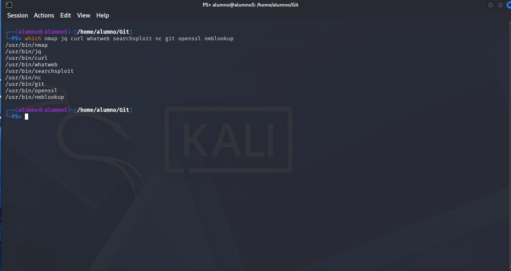
- **Siguiente paso:** clonar el repositorio del proyecto y comprobar el alcance.

### 2026-11-17 antes de las 15:03 - Repositorio clonado y alcance comprobado
- **Cuándo:** 2026-11-17, antes de las 15:03 (no figura en el historial con fecha, que se activó después)
- **Objetivo y alcance:** preparar el repositorio de entrega y fijar la frontera del trabajo.
  Comandos locales; no tocan la red del cliente.
- **Qué hice:** clonado del repositorio `mapping-the-maze-lgomdom0202` de la organización del IES en
  `~/Git/mapping-the-maze-lgomdom0202` (con las plantillas ya subidas), y después
  `cat ./scope.txt` y `ls -R`.
- **Qué salió:** `scope.txt` contiene `172.17.0.0/24`, el rango que autoriza el cliente. El
  repositorio tiene la estructura del enunciado: `cuadernos/` (con este cuaderno),
  `inventario.md`, `registro-vulns.md`, `informe-cliente.md`, `README.md`, `../evidencias/luismi/p1` a
  `p4` e `imagenes/`. La carpeta `agente/` y `comparativa.md` se añadirán en la Parte 5.
- **Captura:** 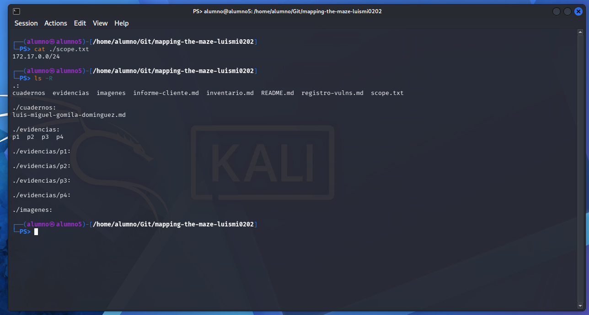
- **Siguiente paso:** pasar la terminal a zsh, activar el historial con fecha y guardar el filtro
  seguro de scripts de nmap.

### 2026-11-17 15:03 - Historial con fecha y filtro seguro de nmap
- **Cuándo:** 2026-11-17 15:03 (historial con fecha) y 15:04 (filtro `SAFE`)
- **Objetivo y alcance:** que todos los comandos siguientes queden registrados con fecha y hora
  para este cuaderno, y limitar los scripts de nmap a los no intrusivos. Configuración local.
- **Qué hice:** cambio de PowerShell a zsh (`zsh`); en `~/.zshrc`,
  `setopt EXTENDED_HISTORY INC_APPEND_HISTORY SHARE_HISTORY` y
  `export SAFE='default and safe and not (intrusive or exploit or dos or brute or malware or broadcast or external or auth)'`;
  comprobación con `echo "$SAFE"`.
- **Qué salió:** el filtro queda guardado: solo se ejecutarán scripts NSE que sean a la vez
  `default` y `safe`, y quedan excluidas las categorías que prohíben las reglas de compromiso
  (exploit, intrusive, dos, brute, malware), además de auth, broadcast y external. Se ve en la
  parte superior de la captura de la entrada siguiente.
- **Captura:** 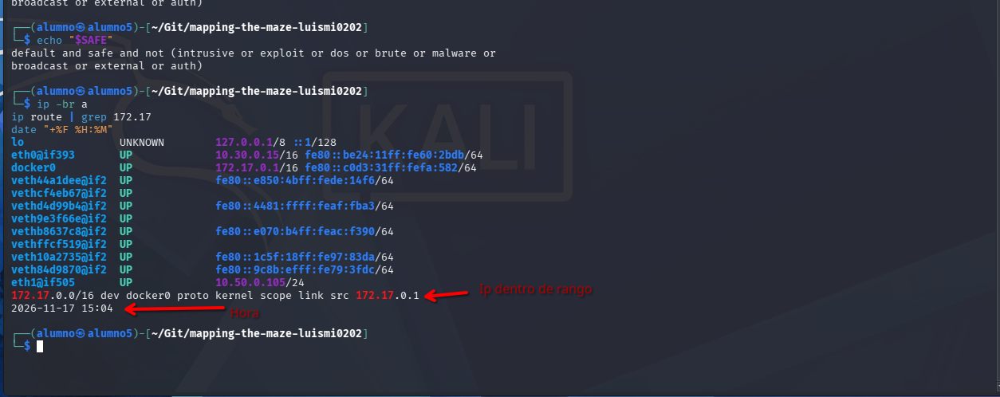
- **Siguiente paso:** identificar desde qué IP trabajo dentro de la red del cliente.

### 2026-11-17 15:04 - IP de trabajo y ruta hacia la red del cliente
- **Cuándo:** 2026-11-17 15:04
- **Objetivo y alcance:** saber desde qué interfaz e IP llego a 172.17.0.0/24, para excluir mi
  propia máquina del inventario. Comandos locales.
- **Qué hice:** `ip -br a`, `ip route | grep 172.17` y `date "+%F %H:%M"`
- **Qué salió:** llego a la red del cliente por la interfaz `docker0`, con IP **172.17.0.1**
  (ruta `172.17.0.0/16 dev docker0 ... src 172.17.0.1`). La interfaz es /16, pero el alcance
  autorizado es solo 172.17.0.0/24: todos los escaneos se lanzarán con `-iL scope.txt` para no
  salir de él. Las otras interfaces, `eth0` (10.30.0.15/16) y `eth1` (10.50.0.105/24), están fuera
  del alcance y no se escanearán. Hay varias interfaces `veth`, que son los equipos del laboratorio
  conectados a `docker0`.
- **Captura:** 
- **Siguiente paso:** Parte 1. Descubrir los equipos vivos de 172.17.0.0/24 y excluir del
  inventario mi propia IP, 172.17.0.1.

---

## Parte 1 - Descubrir y mapear

Criterio de toda la parte: todo se lanza contra `scope.txt` (172.17.0.0/24); sin scripts NSE,
sin `-O` y sin `-A`, solo descubrimiento, escaneo de puertos y detección de versión. La hoja del
cliente no se usa como fuente: solo se contrasta al final. Las horas salen de
`../evidencias/luismi/p1/historial-comandos.txt` y de las cabeceras de nmap.

### 2026-11-17 15:12 - Descubrimiento de equipos vivos
- **Cuándo:** 2026-11-17 15:12 (nmap de 15:12:50 a 15:12:54)
- **Objetivo y alcance:** saber qué IP de 172.17.0.0/24 están vivas, sin escanear puertos. Todo el
  rango está autorizado.
- **Qué hice:** barrido combinando sondas ICMP echo y timestamp, TCP SYN a puertos típicos, TCP
  ACK al 80 y UDP al 53 y 161, para que un equipo que filtre ICMP no se escape:
  `sudo nmap -sn -PE -PP -PS21,22,23,25,80,443,445,3389,8080 -PA80 -PU53,161 -iL scope.txt -oA ../evidencias/luismi/p1/01-descubrimiento`
  y extracción de las IP vivas con
  `awk '/Status: Up/{print $2}' ../evidencias/luismi/p1/01-descubrimiento.gnmap | sort -t. -k4 -n | tee ../evidencias/luismi/p1/vivos.txt`.
- **Qué salió:** 256 direcciones escaneadas en 4 segundos y **9 equipos vivos**: 172.17.0.1 (yo) y
  de 172.17.0.3 a 172.17.0.10, todos con dirección MAC. Evidencias:
  `../evidencias/luismi/p1/01-descubrimiento.{nmap,gnmap,xml}` y `../evidencias/luismi/p1/vivos.txt`.
- **Captura:** 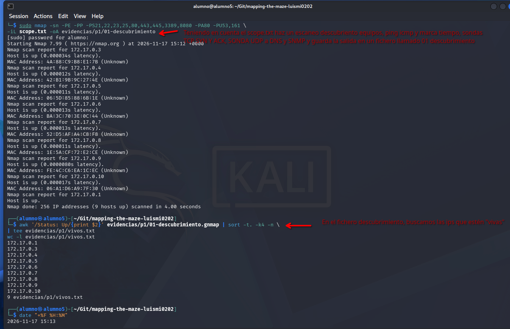
- **Siguiente paso:** contrastar el resultado con un barrido ARP.

### 2026-11-17 15:17 - Contraste con barrido ARP
- **Cuándo:** 2026-11-17 15:17
- **Objetivo y alcance:** confirmar que no se escapa ningún equipo. En una red local un equipo
  puede ignorar ICMP o TCP, pero no ARP. Mismo alcance.
- **Qué hice:** `sudo nmap -sn -PR -iL scope.txt -oA ../evidencias/luismi/p1/02-descubrimiento-arp`, extracción
  a `../evidencias/luismi/p1/vivos-arp.txt` y comparación con
  `diff ../evidencias/luismi/p1/vivos.txt ../evidencias/luismi/p1/vivos-arp.txt && echo "COINCIDEN"`.
- **Qué salió:** `COINCIDEN`. ARP ve exactamente los mismos 9 equipos; no hay equipos ocultos.
  Evidencias: `../evidencias/luismi/p1/02-descubrimiento-arp.{nmap,gnmap,xml}` y `../evidencias/luismi/p1/vivos-arp.txt`.
- **Captura:** 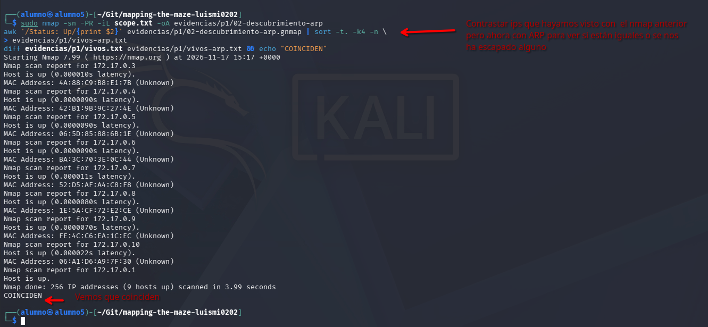
- **Siguiente paso:** quitar mi propia IP de la lista de equipos.

### 2026-11-17 15:20 - Exclusión de mi IP
- **Cuándo:** 2026-11-17 15:20
- **Objetivo y alcance:** que la lista de trabajo solo tenga equipos del cliente.
- **Qué hice:** `MIIP=$(ip -br a | grep -oE '172\.17\.0\.[0-9]+' | head -1)` y
  `grep -vx "$MIIP" ../evidencias/luismi/p1/vivos.txt > /tmp/v && mv /tmp/v ../evidencias/luismi/p1/vivos.txt`.
- **Qué salió:** `../evidencias/luismi/p1/vivos.txt` queda con **8 equipos del cliente, de 172.17.0.3 a
  172.17.0.10**. `vivos-arp.txt` conserva la .1 porque es la salida en bruto del ARP.
- **Captura:** se ve el resultado en la captura de la entrada anterior
  ().
- **Siguiente paso:** pasada suave a cada equipo para localizar el equipo delicado antes de
  escanear a fondo.

### 2026-11-17 15:22 - Pasada suave a todos los equipos
- **Cuándo:** 2026-11-17 15:22 (primera ejecución); la que queda en evidencias es la repetición de
  15:50 a 15:57 (entre 41 y 64 segundos por equipo).
- **Objetivo y alcance:** ver qué corre en cada equipo enviando poco tráfico, para decidir cuál es
  el delicado antes de lanzar un escaneo completo. Los 8 equipos de `vivos.txt`.
- **Qué hice:** bucle sobre `vivos.txt` con
  `sudo nmap -Pn -sS --top-ports 100 -sV --version-light -T2 --max-retries 1 -oA ../evidencias/luismi/p1/03-suave-$ip $ip`
  (100 puertos más comunes, versión ligera, ritmo lento y un solo reintento) y revisión con
  `grep -H "open" ../evidencias/luismi/p1/03-suave-*.nmap`.
- **Qué salió:** todos responden y ninguno se cae. Destacan 172.17.0.3 con **vsftpd 2.3.4**,
  172.17.0.7 con **solo SSH, OpenSSH 7.7** sin paquete de distribución, y 172.17.0.10 con un
  servidor web de Python. El resto muestra Debian o Ubuntu con versiones de paquete. Evidencias:
  `../evidencias/luismi/p1/03-suave-172.17.0.*.{nmap,gnmap,xml}`.
- **Captura:** 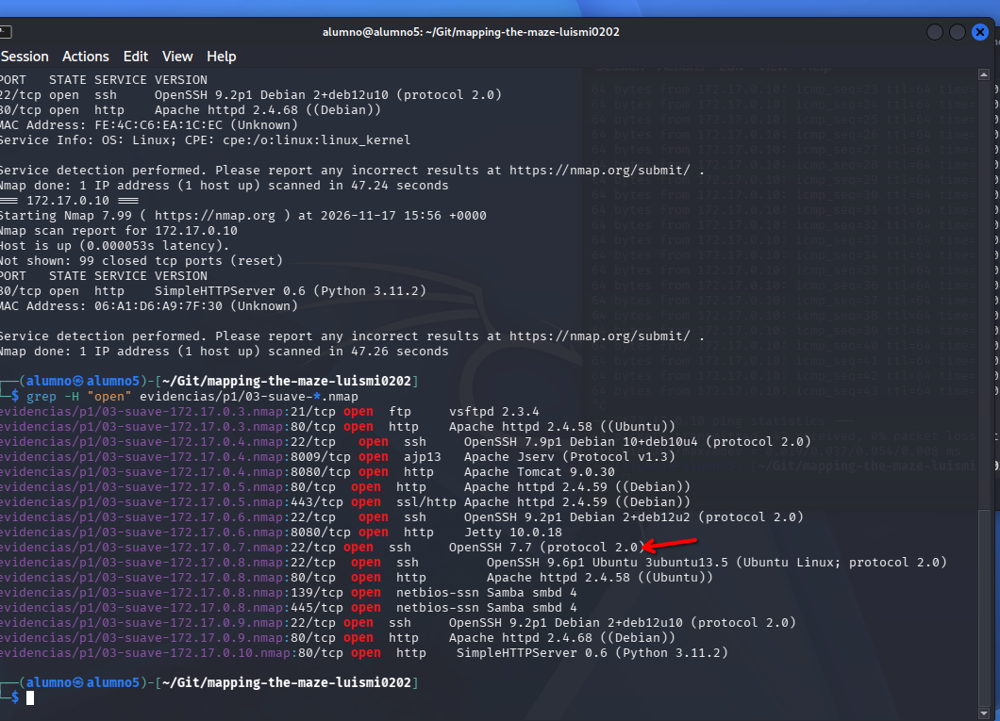
- **Siguiente paso:** comparar los tres candidatos a equipo delicado (.3, .7 y .10).

### 2026-11-17 15:41 - Búsqueda del equipo delicado por tiempos de respuesta
- **Cuándo:** 2026-11-17 15:41 - 15:47
- **Objetivo y alcance:** ver si alguno de los candidatos responde peor que el resto (latencia,
  variación, retransmisiones). Lectura de evidencias y `ping` a tres equipos del alcance.
- **Qué hice:** `grep -H -E "Host is up|scanned in" ../evidencias/luismi/p1/03-suave-172.17.0.{3,7,10}.nmap`;
  bucle `ping -c 20 -i 0.5` a 172.17.0.3, .7 y .10 guardado en `../evidencias/luismi/p1/04-ping-candidatos.txt`;
  `grep -H "<times" ../evidencias/luismi/p1/03-suave-*.xml` y búsqueda de avisos
  (`Warning|retransmission|giving up|RTTVAR`) en las salidas suaves.
- **Qué salió:** no se distinguen. En los XML todos tienen `srtt` entre 40 y 55 µs y `rttvar`
  entre 3 y 11, sin avisos de retransmisión: son contenedores del mismo anfitrión y lo delicado no
  se nota en reposo. **Limitación:** el bucle de `ping` no dejó estadísticas en
  `04-ping-candidatos.txt` (solo las cabeceras `== IP`), así que esa comparación no tiene evidencia
  válida; la vigilancia que sí la tiene es la de las 16:08.
- **Captura:** no hay; la evidencia es `../evidencias/luismi/p1/03-suave-*.xml`.
- **Siguiente paso:** decidir por los banners. 172.17.0.7 es el sistema más antiguo (OpenSSH 7.7,
  de 2018, sin paquete de distribución) y lo trato como equipo delicado.

### 2026-11-17 15:43 - Primer intento de escaneo completo (cancelado)
- **Cuándo:** 2026-11-17 15:43
- **Objetivo y alcance:** probar el escaneo de los 65 535 puertos TCP sobre 172.17.0.3.
- **Qué hice:** `sudo nmap -Pn -sS -p- -T2 --max-rate 30 --max-retries 1 -oA ../evidencias/luismi/p1/10-tcp-all-172.17.0.3 172.17.0.3`
- **Qué salió:** demasiado lento para siete equipos que no son delicados. Lo cancelé; su salida
  quedó sobrescrita por el escaneo de las 16:12.
- **Captura:** no hay (cancelado).
- **Siguiente paso:** fijar el equipo delicado en una variable y escanear el resto a un ritmo
  razonable.

### 2026-11-17 16:08 - Pasada suave vigilada al equipo delicado
- **Cuándo:** 2026-11-17 16:06 (variable) y 16:08 - 16:09 (escaneo de 41,3 segundos)
- **Objetivo y alcance:** confirmar que 172.17.0.7 aguanta un escaneo suave mientras lo vigilo con
  `ping` en otra terminal.
- **Qué hice:** `export FRAGIL=172.17.0.7` (guardado también en `~/.zshrc`). Terminal 1:
  `sudo nmap -Pn -sS --top-ports 100 -sV --version-light -T2 --max-retries 1 -oA ../evidencias/luismi/p1/03b-suave-vigilado-172.17.0.7 172.17.0.7`.
  Terminal 2: `ping 172.17.0.7` durante todo el escaneo.
- **Qué salió:** solo 22/tcp abierto (OpenSSH 7.7). El `ping` dio **43 paquetes enviados, 43
  recibidos, 0 % de pérdida**, rtt 0,017/0,037/0,093 ms: el equipo no sufrió. Evidencias:
  `../evidencias/luismi/p1/03b-suave-vigilado-172.17.0.7.{nmap,gnmap,xml}`.
- **Captura:** 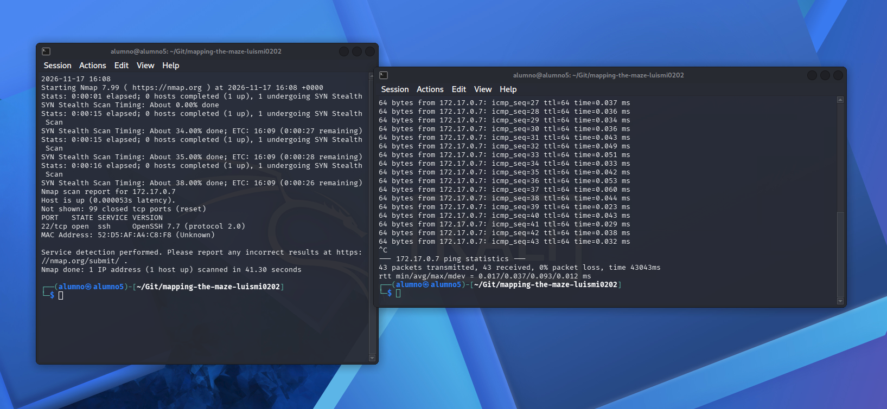
- **Siguiente paso:** escanear todos los puertos TCP, empezando por los equipos normales.

### 2026-11-17 16:12 - Todos los puertos TCP de los 7 equipos normales
- **Cuándo:** 2026-11-17 16:12 - 16:50 (unos 328 segundos por equipo)
- **Objetivo y alcance:** no quedarme en los puertos habituales: los 65 535 puertos TCP de cada
  equipo vivo excepto 172.17.0.7.
- **Qué hice:** bucle sobre `grep -vx "$FRAGIL" ../evidencias/luismi/p1/vivos.txt` con
  `sudo nmap -Pn -sS -p- -T3 --max-rate 200 -oA ../evidencias/luismi/p1/10-tcp-all-$ip $ip`.
- **Qué salió:** aparecen puertos altos que la pasada suave no vio, todos en 172.17.0.5: 1883,
  5672, 8161, 38443, 61613, 61614 y 61616 (el broker de mensajería). Los nombres de servicio de
  esta salida (`http-proxy`, `unknown`...) los pone nmap solo por el número de puerto; los reales
  salen en la detección de versión de las 18:37. Evidencias:
  `../evidencias/luismi/p1/10-tcp-all-172.17.0.{3,4,5,6,8,9,10}.{nmap,gnmap,xml}`.
- **Captura:** 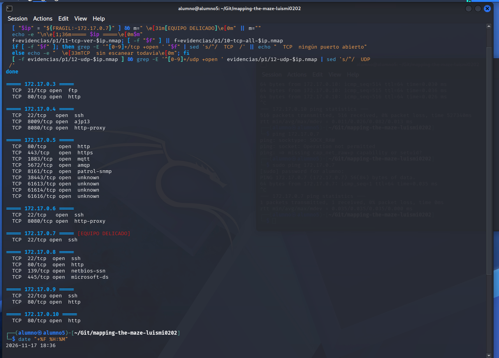
- **Siguiente paso:** escanear todos los puertos del equipo delicado, más despacio.

### 2026-11-17 16:54 - Todos los puertos TCP del equipo delicado
- **Cuándo:** 2026-11-17 16:54 (primer intento, cancelado) y 17:56 - 18:33 (escaneo válido,
  2 185 segundos)
- **Objetivo y alcance:** los 65 535 puertos TCP de 172.17.0.7 sin tumbarlo.
- **Qué hice:** primer intento con
  `sudo nmap -Pn -sS -p- -T2 --max-rate 30 --max-retries 1 -oA ../evidencias/luismi/p1/10-tcp-all-$FRAGIL $FRAGIL`,
  cancelado porque estimaba más de 6 horas. Segundo intento con
  `sudo nmap -Pn -sS -p- -T3 --max-rate 30 --max-retries 1 -oA ../evidencias/luismi/p1/10-tcp-all-$FRAGIL $FRAGIL`:
  el límite real lo pone `--max-rate 30` (como mucho 30 paquetes por segundo), no la plantilla
  de tiempos. Revisión con `grep open ../evidencias/luismi/p1/10-tcp-all-$FRAGIL.nmap`.
- **Qué salió:** 65 534 puertos cerrados y **solo 22/tcp abierto**. El equipo siguió respondiendo
  durante todo el escaneo. Evidencias: `../evidencias/luismi/p1/10-tcp-all-172.17.0.7.{nmap,gnmap,xml}`.
- **Captura:** se incluye en la captura del escaneo completo
  ().
- **Siguiente paso:** detectar la versión de cada puerto abierto.

### 2026-11-17 18:37 - Versión de cada puerto TCP abierto
- **Cuándo:** 2026-11-17 18:37 - 18:39; el equipo delicado se repitió a las 19:01
- **Objetivo y alcance:** saber qué producto y versión hay detrás de cada puerto abierto. Solo
  `-sV` sobre los puertos ya encontrados, sin scripts ni detección de sistema operativo.
- **Qué hice:** bucle sobre `vivos.txt` que saca los puertos abiertos de cada
  `10-tcp-all-$ip.gnmap` y lanza `sudo nmap -Pn -sV -p $ports -oA ../evidencias/luismi/p1/11-tcp-ver-$ip $ip`;
  para el equipo delicado, `-sV --version-light -T2 --max-retries 1`. Mientras corría lo vigilé
  con `sudo ping 172.17.0.6`. En el bucle, la IP del equipo delicado quedó en una línea aparte, así
  que a las 19:01 revisé su salida y lo repetí solo:
  `sudo nmap -Pn -sV --version-light -T2 --max-retries 1 -p 22 -oA ../evidencias/luismi/p1/11-tcp-ver-172.17.0.7 172.17.0.7`.
- **Qué salió:**

  | IP | Puertos TCP abiertos y versión |
  |---|---|
  | 172.17.0.3 | 21 vsftpd 2.3.4 · 80 Apache httpd 2.4.58 (Ubuntu) |
  | 172.17.0.4 | 22 OpenSSH 7.9p1 Debian 10+deb10u4 · 8009 ajp13 Apache Jserv 1.3 · 8080 Apache Tomcat 9.0.30 |
  | 172.17.0.5 | 80 y 443 Apache httpd 2.4.59 (Debian) · 1883 mqtt · 5672 amqp? (responde `AMQP`) · 8161 Jetty 9.4.39 · 38443 tcpwrapped · 61613 stomp Apache ActiveMQ · 61614 Jetty 9.4.39 · 61616 ActiveMQ OpenWire 5.15.15 |
  | 172.17.0.6 | 22 OpenSSH 9.2p1 Debian 2+deb12u2 · 8080 Jetty 10.0.18 |
  | 172.17.0.7 | 22 OpenSSH 7.7 (protocol 2.0) |
  | 172.17.0.8 | 22 OpenSSH 9.6p1 Ubuntu 3ubuntu13.5 · 80 Apache httpd 2.4.58 (Ubuntu) · 139 y 445 Samba smbd 4 |
  | 172.17.0.9 | 22 OpenSSH 9.2p1 Debian 2+deb12u10 · 80 Apache httpd 2.4.68 (Debian) |
  | 172.17.0.10 | 80 SimpleHTTPServer 0.6 (Python 3.11.2) |

  **Aviso (no se toca):** vsftpd 2.3.4 en 172.17.0.3:21 es una versión conocida por llevar una
  puerta trasera, y ActiveMQ 5.15.15 en 172.17.0.5:61616 es una versión antigua del broker. Solo
  se ha leído el banner; se estudian en la Parte 3. Evidencias:
  `../evidencias/luismi/p1/11-tcp-ver-172.17.0.*.{nmap,gnmap,xml}`.
- **Capturas:**

  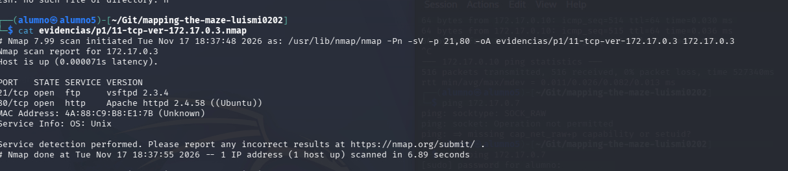

  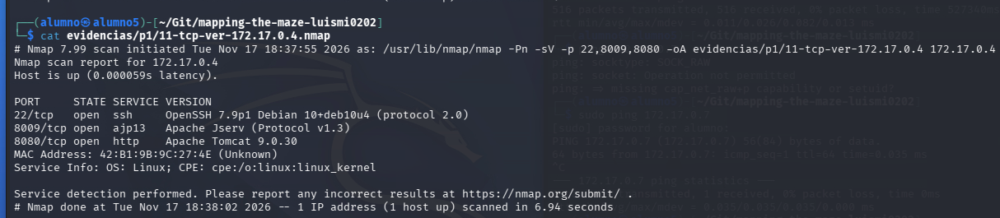

  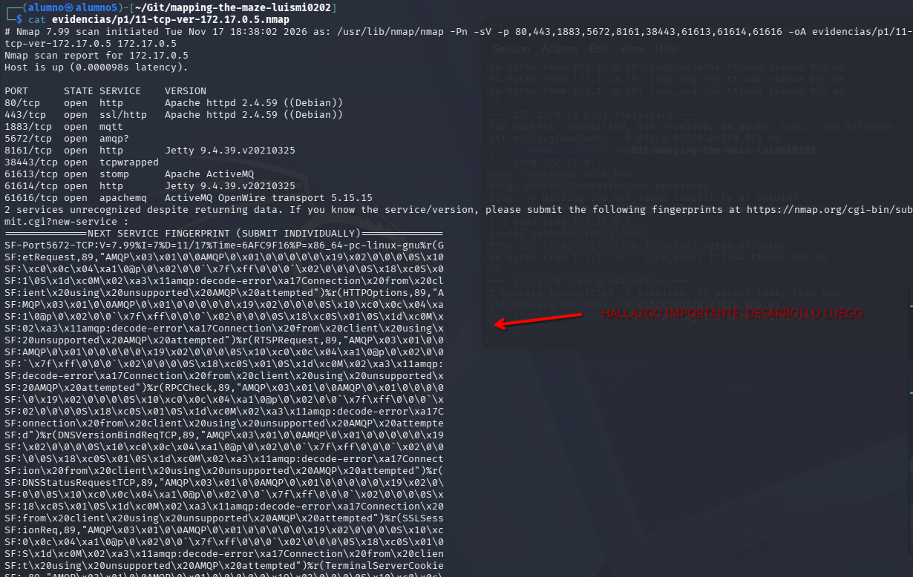

  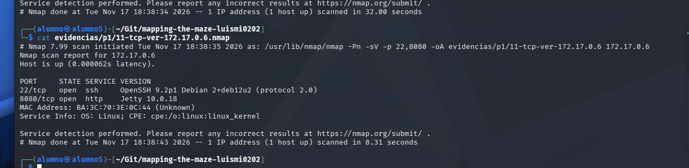

  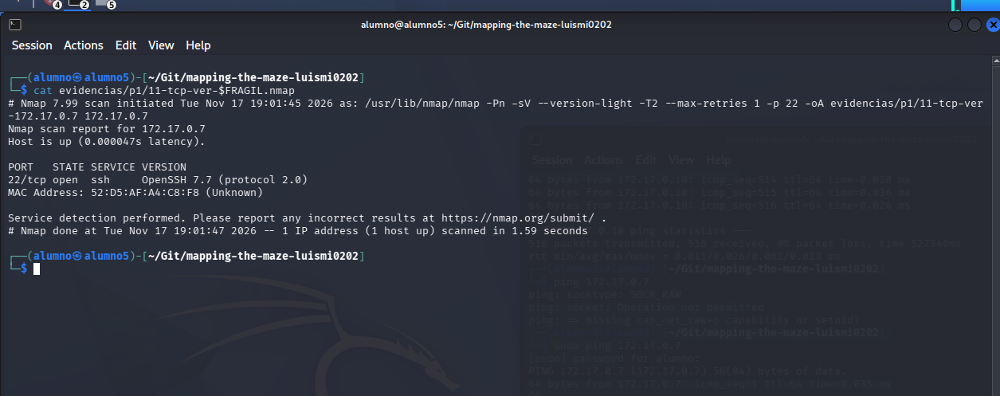

  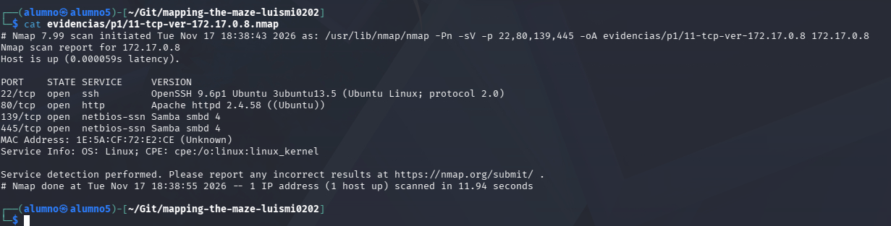

  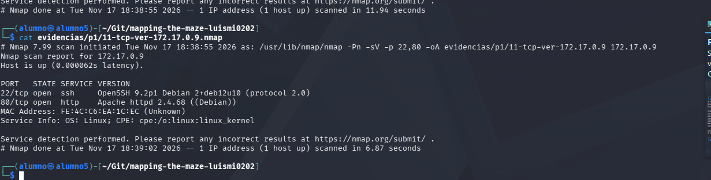

  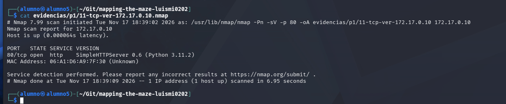
- **Siguiente paso:** UDP, porque no todo habla TCP.

### 2026-11-17 18:48 - Puertos UDP
- **Cuándo:** 2026-11-17 18:48 - 18:51 (equipos normales) y 18:51 (equipo delicado)
- **Objetivo y alcance:** encontrar servicios UDP en los 8 equipos. UDP es lento y poco fiable, así
  que limito puertos, reintentos y velocidad.
- **Qué hice:** antes, `sudo ping 172.17.0.3` para comprobar que los equipos seguían respondiendo.
  Equipos normales:
  `sudo nmap -Pn -sU --top-ports 100 -sV --version-intensity 0 --max-retries 1 -T3 --max-rate 100 -oA ../evidencias/luismi/p1/12-udp-$ip $ip`.
  Equipo delicado, solo 10 puertos típicos, despacio y sin `-sV`:
  `sudo nmap -Pn -sU -p 53,67,69,123,137,161,500,623,1900,5353 --max-retries 1 -T2 -oA ../evidencias/luismi/p1/12-udp-$FRAGIL $FRAGIL`.
- **Qué salió:**
  - **172.17.0.8: 137/udp abierto**, Samba nmbd netbios-ns (workgroup: DL).
  - **172.17.0.10: 623/udp abierto**, asf-rmcp (RMCP/IPMI, gestión remota de servidores), sin versión.
  - 172.17.0.7: todo cerrado salvo 69/udp (TFTP) `open|filtered`, sin confirmar.
  - Resto: entre 90 y 93 puertos `open|filtered` por equipo, sin respuesta; no se cuentan como
    abiertos. El aviso `retransmission cap hit (1)` es por el límite de un reintento que puse a
    propósito.

  Evidencias: `../evidencias/luismi/p1/12-udp-172.17.0.*.{nmap,gnmap,xml}`.
- **Capturas:**

  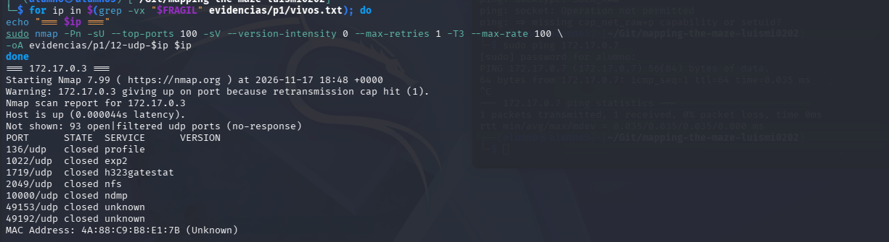

  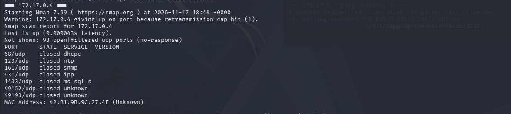

  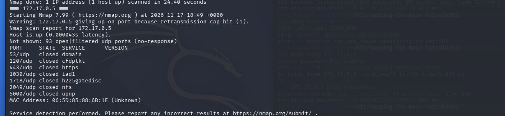

  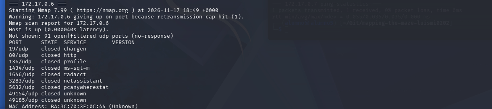

  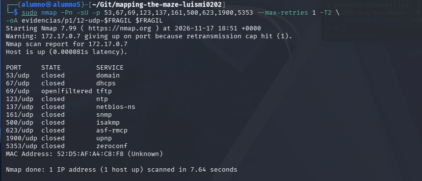

  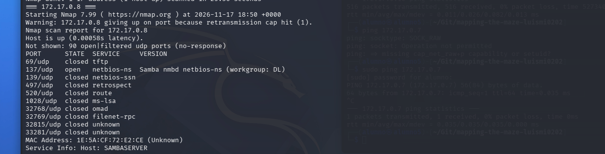

  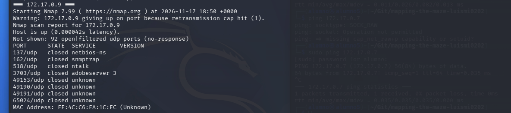

  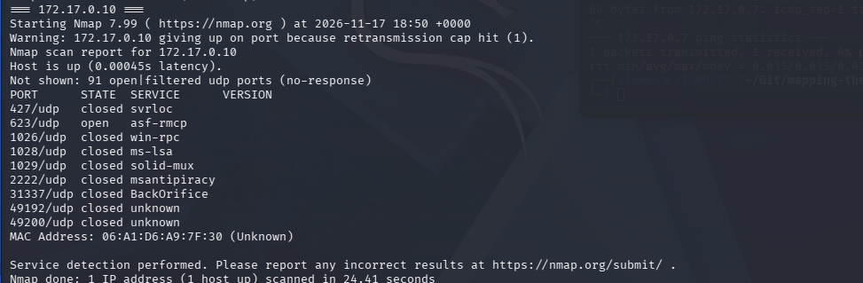
- **Siguiente paso:** juntar todos los puertos abiertos en un resumen.

### 2026-11-17 18:55 - Resumen de puertos abiertos
- **Cuándo:** 2026-11-17 18:55; regenerado a las 19:02 tras repetir la versión del equipo delicado
- **Objetivo y alcance:** una sola lista con todo lo abierto (TCP con versión y UDP) para el
  inventario. Solo se leen evidencias.
- **Qué hice:** bucle sobre `../evidencias/luismi/p1/11-tcp-ver-*.nmap` y `../evidencias/luismi/p1/12-udp-*.nmap` con
  `grep -E "^[0-9]+/(tcp|udp) +open "`, guardado con `tee ../evidencias/luismi/p1/resumen-puertos.txt`.
- **Qué salió:** **8 equipos, 24 puertos TCP y 2 puertos UDP abiertos**. Evidencia:
  `../evidencias/luismi/p1/resumen-puertos.txt`.
- **Captura:** 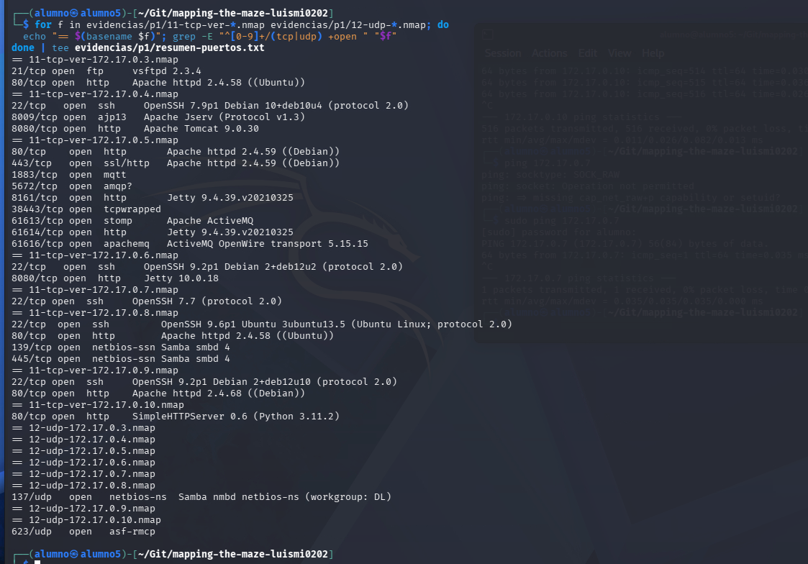
- **Siguiente paso:** ahora sí, contrastar con la hoja del cliente.

### 2026-11-17 19:02 - Contraste con el inventario del cliente
- **Cuándo:** 2026-11-17, después de las 19:02
- **Objetivo y alcance:** ver qué sobra, qué falta y qué está mal en la hoja del cliente.
  Comparación en papel; no se escanea nada nuevo. La entrada 172.17.1.6 de la hoja está fuera del
  alcance y **no se ha tocado**.
- **Qué hice:** abrí `inventario-cliente.csv` en LibreOffice y lo comparé fila a fila con
  `vivos.txt` y `resumen-puertos.txt`.
- **Qué salió:**
  - **Sobran (7):** 172.17.0.2, .11, .20, .30, .50, .100 y .254 no responden en ningún barrido
    (tampoco en ARP).
  - **Mal (2):** 172.17.0.9 no es un Windows 7 con escritorio remoto sino un Debian 12 con SSH y
    Apache; 172.17.0.10 no es un Windows Server 2008 con IIS sino un servidor web de Python con
    IPMI en 623/udp.
  - **Fuera de alcance (1):** PC-PRUEBAS, 172.17.1.6. Sin comprobar; hay que preguntar al cliente.
  - **Faltan (6):** de 172.17.0.3 a 172.17.0.8, entre ellos el FTP real (vsftpd en .3), el portal
    y la mensajería reales (Apache y ActiveMQ en .5) y las carpetas compartidas (Samba en .8).
  - **Nombre duplicado:** SRV-PORTAL01 aparece con dos IP (.10 y .11) y la propia hoja duda si es
    la misma máquina; la red no lo aclara (.11 no responde y .10 no tiene IIS ni SQL Server).
  - srv-backup (OpenSSH 5.5, Debian 7) no parece ser 172.17.0.7: las versiones de SSH no coinciden.
  - La hoja describe una red antigua, mayoritariamente Windows, más Ubuntu 12.04, Debian 7,
    Synology e iLO 2. Lo observado es Linux donde los banners lo permiten saber; en .7 y .10 el
    sistema no se pudo identificar.

  Detalle completo en [inventario.md](../inventario.md#correcciones-al-inventario-del-cliente).
- **Captura:** 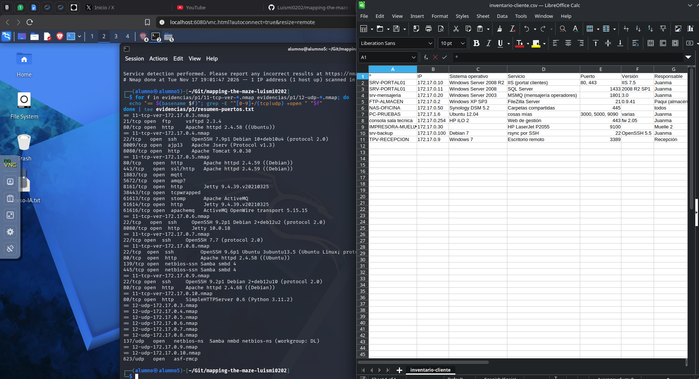
- **Siguiente paso:** guardar el historial de comandos y redactar el inventario.

### 2026-11-17 19:10 - Historial de comandos guardado
- **Cuándo:** 2026-11-17 19:10
- **Objetivo y alcance:** dejar como evidencia todos los comandos de la sesión con su hora.
  Comando local.
- **Qué hice:** exporté el historial de zsh con fecha (`fc -li`) a
  `../evidencias/luismi/p1/historial-comandos.txt` y lo comprobé con `wc -l`.
- **Qué salió:** el fichero tiene todas las órdenes con su hora, incluidos los intentos
  cancelados y repetidos. Es la fuente de las horas de esta parte. El 2026-11-18 se le añadieron
  los comandos de subida de estas evidencias (19:11 a 19:24), que estaban en el historial de la
  Parte 2 (ver «Historiales separados por parte», en la Parte 4).
- **Captura:** no hay; la evidencia es `../evidencias/luismi/p1/historial-comandos.txt`.
- **Siguiente paso:** Parte 2. Enumerar sin autenticar cada servicio, empezando por los puertos
  altos de 172.17.0.5, Samba y NetBIOS en 172.17.0.8 e IPMI en 172.17.0.10. 172.17.0.7 se seguirá
  tratando como equipo delicado.

### Resumen de la Parte 1
- 8 equipos vivos del cliente (de 172.17.0.3 a 172.17.0.10), confirmados con dos métodos de
  descubrimiento.
- 24 puertos TCP y 2 UDP abiertos, con versión en casi todos (sin identificar: 1883/mqtt,
  38443/tcpwrapped y 623/udp).
- Equipo delicado: 172.17.0.7, escaneado con límites y vigilado sin pérdida de paquetes.
- Dos hallazgos graves anotados sin tocar: vsftpd 2.3.4 (172.17.0.3) y ActiveMQ 5.15.15
  (172.17.0.5).
- Entregable: [inventario.md](../inventario.md).

---

## Parte 2 - Enumerar sin autenticar

Criterio de toda la parte: solo scripts NSE de las categorías default y safe a la vez (filtro
`$SAFE`), scripts sueltos comprobados antes con `--script-help`, banners con `nc` y peticiones HTTP
normales con `curl`. Sin credenciales, sin sesiones anónimas y sin fuerza bruta. Todo dentro de
172.17.0.0/24 (scope.txt). Las horas y los comandos salen de `../evidencias/luismi/p2/historial-comandos.txt`.

### 2026-11-17 20:27 - Preparación de la Parte 2
- **Cuándo:** 2026-11-17 20:27 - 20:31
- **Objetivo y alcance:** comprobar que el filtro seguro y la variable del equipo delicado siguen
  cargados, y repasar los puertos abiertos de la Parte 1. Comandos locales; no envían tráfico.
- **Qué hice:** `echo "SAFE=$SAFE"`, `export FRAGIL=172.17.0.7` y `cat ../evidencias/luismi/p1/resumen-puertos.txt`
- **Qué salió:** `$SAFE` contiene el filtro `default and safe and not (intrusive or exploit or dos
  or brute or malware or broadcast or external or auth)` y `FRAGIL` vale 172.17.0.7. Lista de
  trabajo: 24 puertos TCP y 2 UDP en 8 equipos (`../evidencias/luismi/p1/resumen-puertos.txt`).
- **Captura:** sin captura.
- **Siguiente paso:** lanzar los scripts NSE seguros sobre todos los puertos abiertos.

### 2026-11-17 20:38 - Scripts NSE seguros sobre todos los puertos abiertos
- **Cuándo:** 2026-11-17 20:38 (nmap de 20:38:23 a 20:39:46)
- **Objetivo y alcance:** primera enumeración de cada servicio con scripts no intrusivos, sobre
  los puertos TCP abiertos de los 7 equipos no delicados (172.17.0.3, .4, .5, .6, .8, .9 y .10),
  dentro de 172.17.0.0/24 (scope.txt).
- **Qué hice:**
  `for ip in $(grep -vx "$FRAGIL" ../evidencias/luismi/p1/vivos.txt); do ports=$(grep -oE '[0-9]+/open/tcp' ../evidencias/luismi/p1/10-tcp-all-$ip.gnmap | cut -d/ -f1 | paste -sd, -); [ -z "$ports" ] && continue; echo "=== $ip : $ports ==="; sudo nmap -Pn -sV -p $ports --script "$SAFE" -oA ../evidencias/luismi/p2/20-nse-$ip $ip; done`
- **Qué salió:**
  - Títulos y cabeceras web de todos los servidores y claves de host SSH.
  - 172.17.0.4:8009: métodos AJP.
  - 172.17.0.5: certificado caducado, topics de aviso de MQTT (`mqtt-subscribe`), `TRACE` en 61614
    y error de `amqp-info` en 5672. `mqtt-subscribe` no lo pide el filtro: es de la categoría
    `version` (no default) y nmap lo lanzó por su cuenta al usar `-sV` (ver entrada «Categorías de
    mqtt-subscribe», en la Parte 4).
  - 172.17.0.6:8080: `robots.txt`.
  - 172.17.0.8: firma SMB no obligatoria y nombre NetBIOS `SAMBASERVER`.

  Evidencias: `../evidencias/luismi/p2/20-nse-172.17.0.*.nmap`. Las salidas se revisaron con `cat` de 20:45 a 20:48.
- **Captura:**

  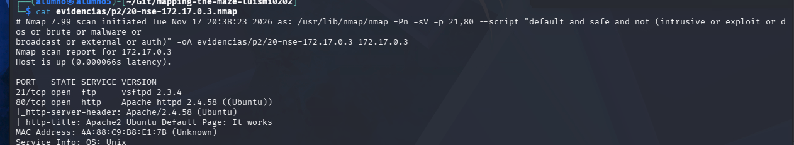

  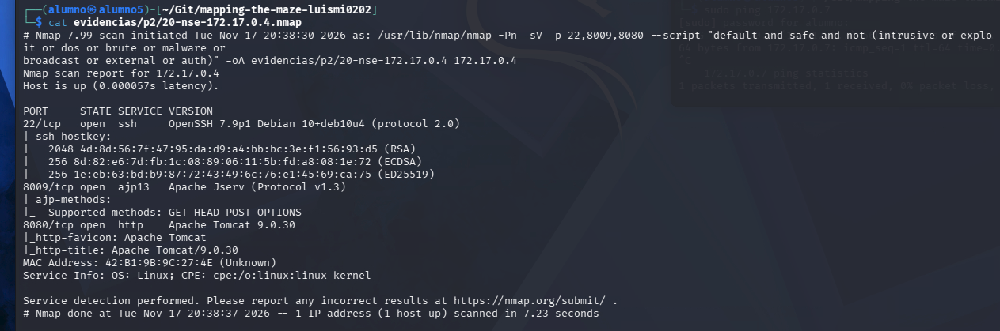

  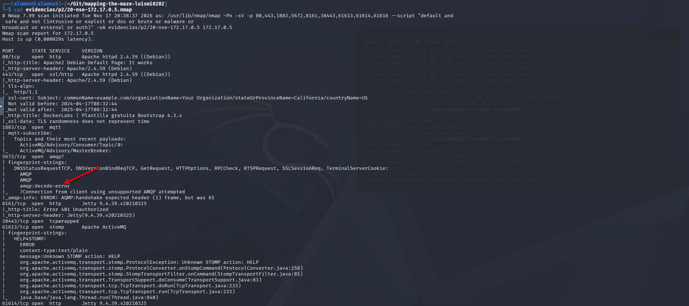

  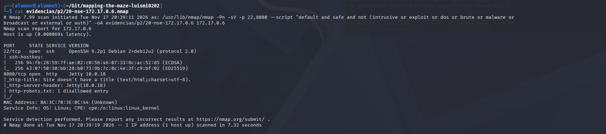

  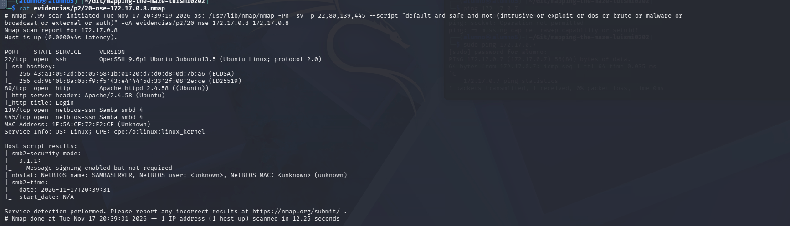

  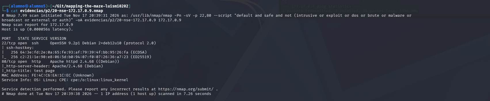

  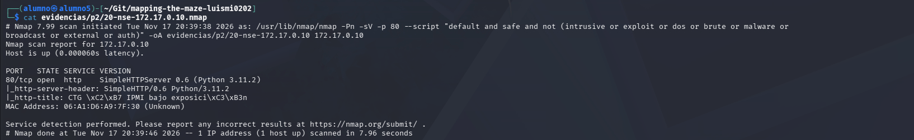
- **Siguiente paso:** repetir sobre el equipo delicado, más despacio.

### 2026-11-17 20:41 - Scripts NSE seguros sobre el equipo delicado
- **Cuándo:** 2026-11-17 20:41 (nmap de 20:41:52 a 20:41:54)
- **Objetivo y alcance:** enumerar el único puerto abierto de 172.17.0.7 (22/tcp) enviando el
  mínimo tráfico posible. Dentro de 172.17.0.0/24 (scope.txt).
- **Qué hice:**
  `ports=$(grep -oE '[0-9]+/open/tcp' ../evidencias/luismi/p1/10-tcp-all-$FRAGIL.gnmap | cut -d/ -f1 | paste -sd, -)` y
  `sudo nmap -Pn -sV --version-light -T2 --max-retries 1 -p $ports --script "$SAFE" -oA ../evidencias/luismi/p2/20-nse-$FRAGIL $FRAGIL`
- **Qué salió:** OpenSSH 7.7 (protocol 2.0) con claves de host RSA 2048, ECDSA 256 y ED25519 256.
  Terminó en 1,86 s y el equipo siguió respondiendo. Evidencia: `../evidencias/luismi/p2/20-nse-172.17.0.7.nmap`.
- **Captura:** 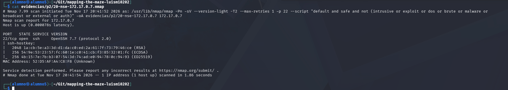
- **Siguiente paso:** comprobar las categorías de los scripts sueltos antes de lanzarlos.

### 2026-11-17 20:50 - Categorías de los scripts sueltos
- **Cuándo:** 2026-11-17 20:50
- **Objetivo y alcance:** demostrar que ningún script suelto que voy a usar es intrusive, exploit,
  dos, brute, malware ni auth. Comando local; no envía tráfico a la red.
- **Qué hice:**
  `clear; date "+%F %H:%M"; for s in ssh2-enum-algos ssh-hostkey smb-os-discovery smb2-security-mode smb-security-mode smb-protocols nbstat ipmi-version amqp-info; do nmap --script-help $s | grep -iE "^$s|categories"; done | tee ../evidencias/luismi/p2/20-categorias-scripts.txt`
- **Qué salió:** todos son safe y discovery (algunos también default o version). Ninguno pertenece
  a una categoría prohibida. Aun así, decidí no usar `smb-os-discovery` porque inicia una sesión
  anónima. Evidencia: `../evidencias/luismi/p2/20-categorias-scripts.txt`.
- **Captura:** 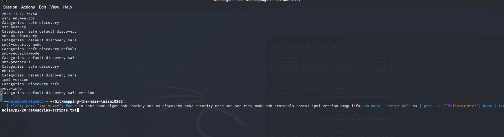
- **Siguiente paso:** enumerar los servicios web.

### 2026-11-17 21:06 - Servicios web: cabeceras, robots.txt, pistas y whatweb
- **Cuándo:** 2026-11-17 21:06 (respuestas HTTP con `Date` de 21:06:41 a 21:07:09)
- **Objetivo y alcance:** ver qué enseña sola cada web, sin buscar rutas ni probar logins. Los 10
  servicios web: 172.17.0.3:80, .4:8080, .5:80, .5:443, .5:8161, .5:61614, .6:8080, .8:80, .9:80
  y .10:80, dentro de 172.17.0.0/24 (scope.txt).
- **Qué hice:**
  `for s in 172.17.0.3:80:http 172.17.0.4:8080:http 172.17.0.5:80:http 172.17.0.5:443:https 172.17.0.5:8161:http 172.17.0.5:61614:http 172.17.0.6:8080:http 172.17.0.8:80:http 172.17.0.9:80:http 172.17.0.10:80:http; do IP=${s%%:*}; r=${s#*:}; P=${r%%:*}; PR=${r#*:}; URL=$PR://$IP:$P; curl -sk -m 10 -I $URL | tee ../evidencias/luismi/p2/21-http-cabeceras-$IP-$P.txt; curl -sk -m 10 $URL/robots.txt | head -30 | tee ../evidencias/luismi/p2/21-http-robots-$IP-$P.txt; curl -sk -m 10 $URL/ | grep -iE "generator|version|author|<title|mailto|@|<" | head -40 | tee ../evidencias/luismi/p2/21-http-pistas-$IP-$P.txt; whatweb -a 1 $URL 2>/dev/null | tee ../evidencias/luismi/p2/21-whatweb-$IP-$P.txt; done`
  
  En el historial aparece dos veces seguidas a las 21:06. La primera llevaba también el
  `openssl` del certificado; lo separé y lo lancé aparte en la entrada siguiente. La segunda
  ejecución es la que queda en las evidencias. Como el filtro de pistas incluye `<`, recoge casi
  cualquier línea HTML; por eso se limitó a las 40 primeras con `head -40`.
- **Qué salió:**
  - 172.17.0.6:8080 es **Jenkins 2.441** (`X-Jenkins: 2.441`) sobre Jetty 10.0.18, con login
    obligatorio y `robots.txt` con `Disallow: /`.
  - 172.17.0.5:443 es una web Bootstrap con autor `Devcrud` y el correo `info@dockerlabs.lab`.
  - 172.17.0.5:8161 es la consola de ActiveMQ y pide autenticación básica (`ActiveMQRealm`).
  - 172.17.0.8:80 y 172.17.0.9:80 tienen páginas de login; 172.17.0.10:80 es una página sobre IPMI.
  - 172.17.0.3:80 y 172.17.0.5:80 sirven la página por defecto de Apache.
  - Ninguna otra web tiene `robots.txt`.

  Evidencias: `../evidencias/luismi/p2/21-http-*` y `../evidencias/luismi/p2/21-whatweb-*`.
- **Captura:** se hicieron de 21:10 a 21:16 con `clear; date "+%F %H:%M"; tail -n +1 ../evidencias/luismi/p2/21-*-$IP-$P.txt`.
  A las 21:11 lo lancé dos veces sobre `172.17.0.4-80`, que no existe (el puerto web de la .4 es
  el 8080), y lo corregí.

  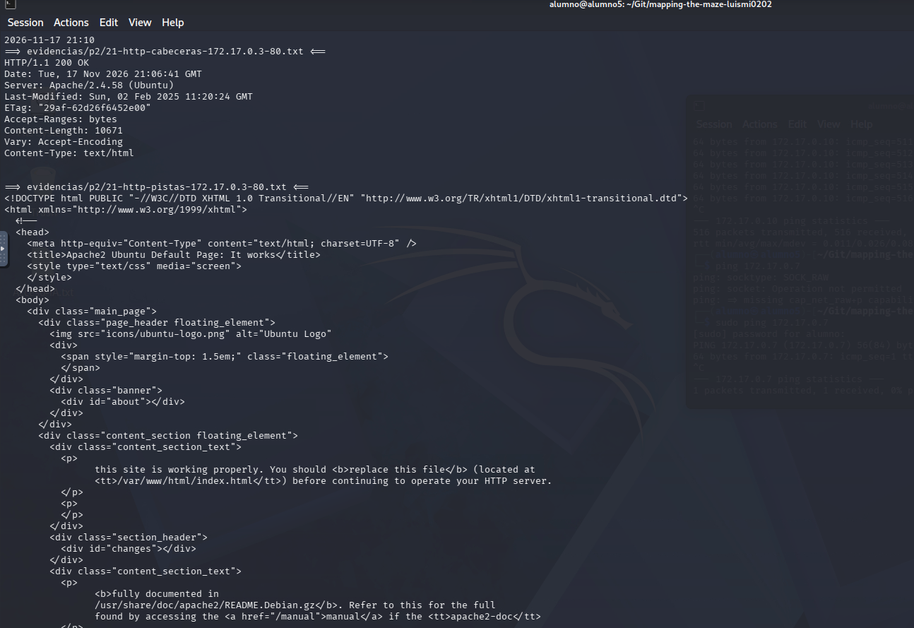

  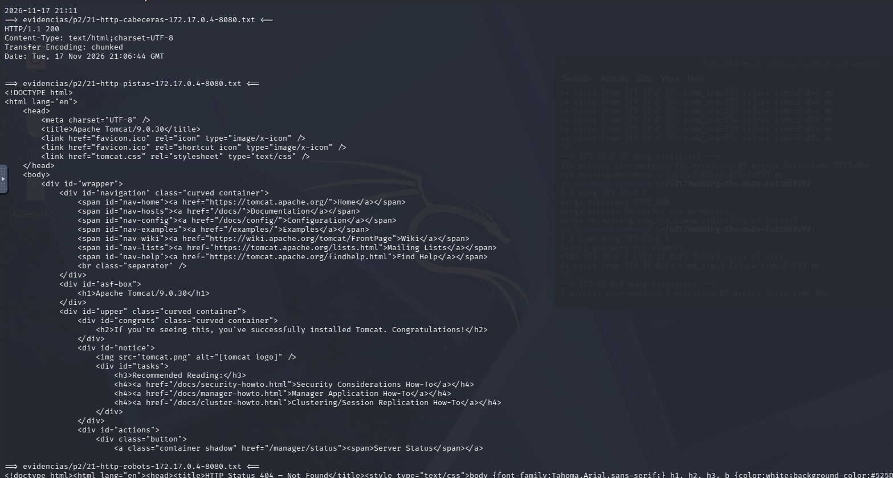

  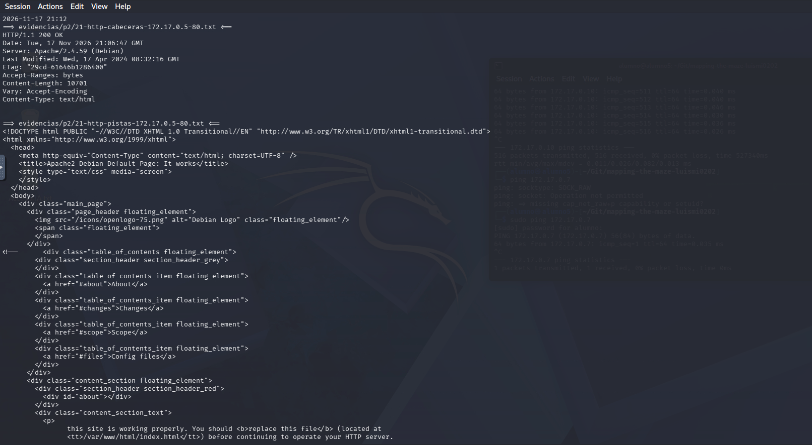

  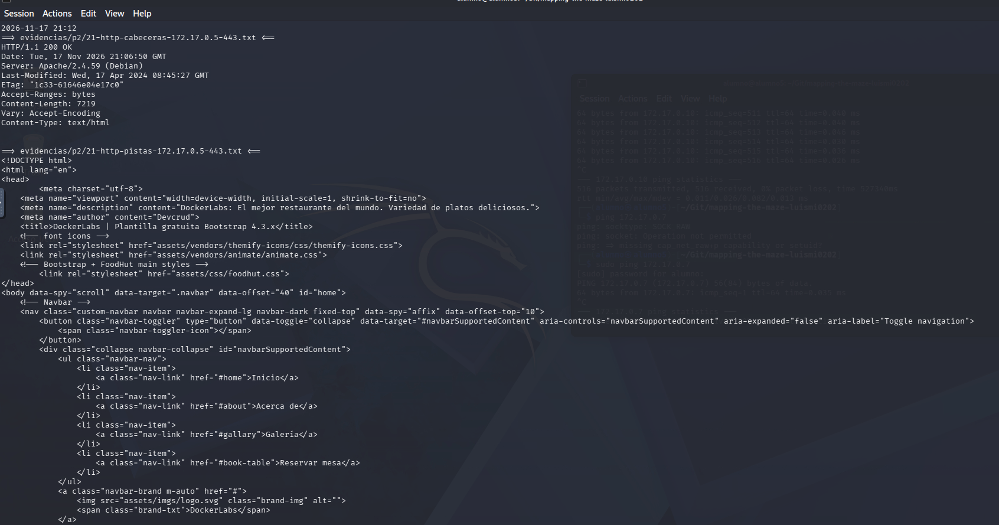

  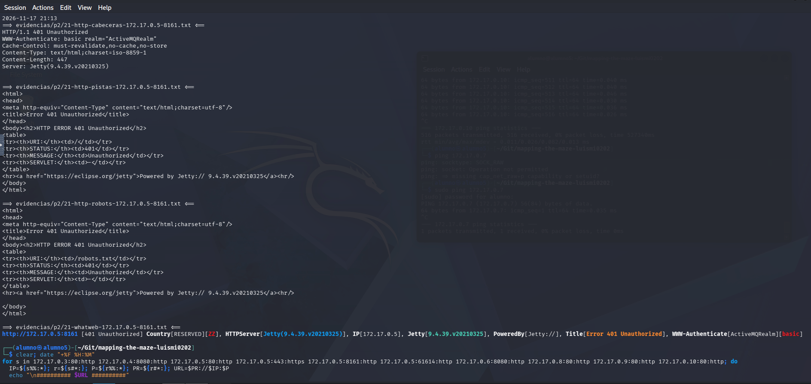

  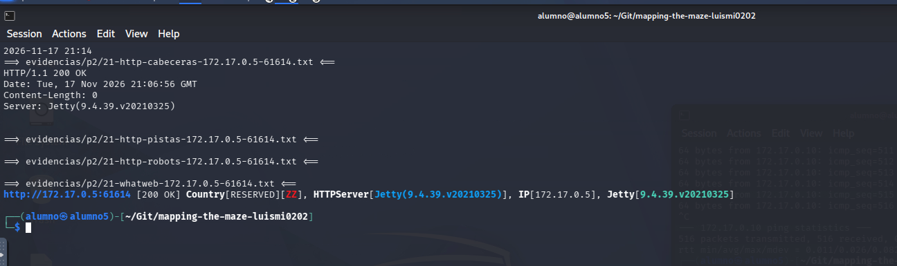

  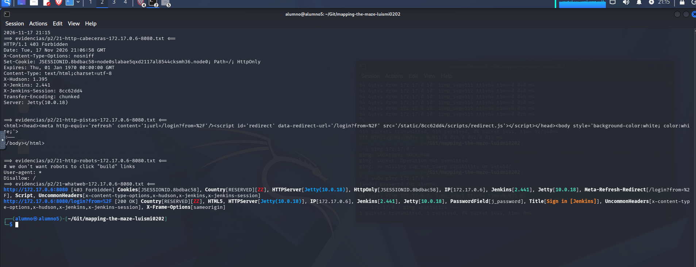

  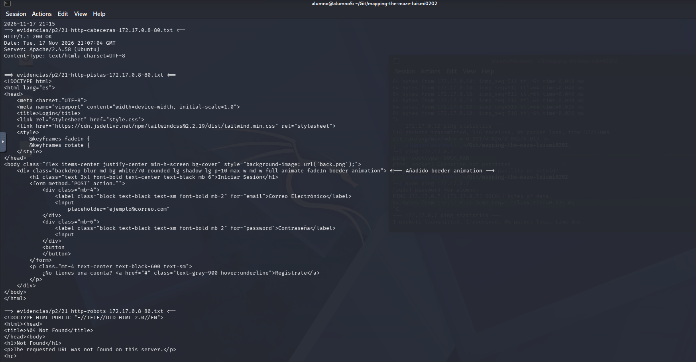

  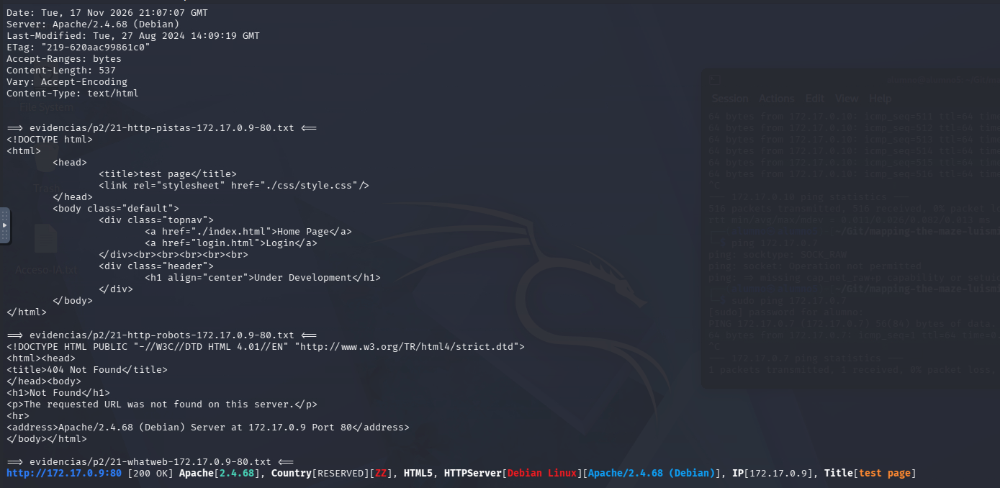

  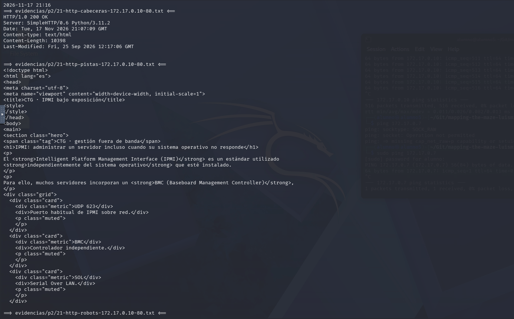
- **Siguiente paso:** leer el certificado del único servicio HTTPS.

### 2026-11-17 21:08 - Certificado TLS de 172.17.0.5:443
- **Cuándo:** 2026-11-17 21:08 (revisado con `cat` a las 21:17)
- **Objetivo y alcance:** ver organización, nombres y caducidad del certificado de 172.17.0.5:443,
  dentro de 172.17.0.0/24 (scope.txt).
- **Qué hice:** `echo | openssl s_client -connect 172.17.0.5:443 2>/dev/null | openssl x509 -noout -subject -issuer -dates | tee ../evidencias/luismi/p2/21-tls-cert-172.17.0.5-443.txt`
- **Qué salió:** CN=example.com, O=Your Organization. El emisor es el mismo sujeto (autofirmado) y
  el certificado es válido del 2024-04-17 al 2025-04-17: **caducado**. No incluye nombres ni correos.
  Evidencia: `../evidencias/luismi/p2/21-tls-cert-172.17.0.5-443.txt`.
- **Captura:** 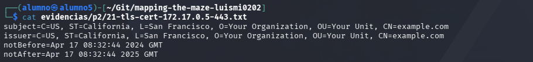
- **Siguiente paso:** banner y algoritmos de los servidores SSH.

### 2026-11-17 21:18 - SSH: banner y algoritmos
- **Cuándo:** 2026-11-17 21:18 (172.17.0.4, .6, .8 y .9) y 21:20 (172.17.0.7); capturas de 21:22 a 21:25
- **Objetivo y alcance:** versión exacta con distribución (necesaria en la Parte 3 para descartar
  falsos positivos) y algoritmos que admite cada SSH, sin intentar iniciar sesión. 172.17.0.4, .6,
  .7, .8 y .9, dentro de 172.17.0.0/24 (scope.txt).
- **Qué hice:**
  `for IP in 172.17.0.4 172.17.0.6 172.17.0.8 172.17.0.9; do nc -nv -w 3 $IP 22 </dev/null 2>&1 | tee ../evidencias/luismi/p2/22-ssh-banner-$IP.txt; sudo nmap -Pn -p 22 --script ssh2-enum-algos,ssh-hostkey $IP -oA ../evidencias/luismi/p2/22-ssh-$IP; done`
  y, para el equipo delicado, aparte y despacio:
  `nc -nv -w 3 172.17.0.7 22 </dev/null 2>&1 | tee ../evidencias/luismi/p2/22-ssh-banner-172.17.0.7.txt` y
  `sudo nmap -Pn -T2 --max-retries 1 -p 22 --script ssh2-enum-algos,ssh-hostkey 172.17.0.7 -oA ../evidencias/luismi/p2/22-ssh-172.17.0.7`
- **Qué salió:**
  - Banners: .4 `OpenSSH_7.9p1 Debian-10+deb10u4`, .6 `OpenSSH_9.2p1 Debian-2+deb12u2`,
    .7 `OpenSSH_7.7`, .8 `OpenSSH_9.6p1 Ubuntu-3ubuntu13.5` y .9 `OpenSSH_9.2p1 Debian-2+deb12u10`.
  - .4 y .7 admiten `diffie-hellman-group14-sha1` y claves de host `ssh-rsa`.
  - Todos admiten `hmac-sha1`.

  Evidencias: `../evidencias/luismi/p2/22-ssh-banner-*.txt` y `../evidencias/luismi/p2/22-ssh-*.nmap`.
- **Captura:**

  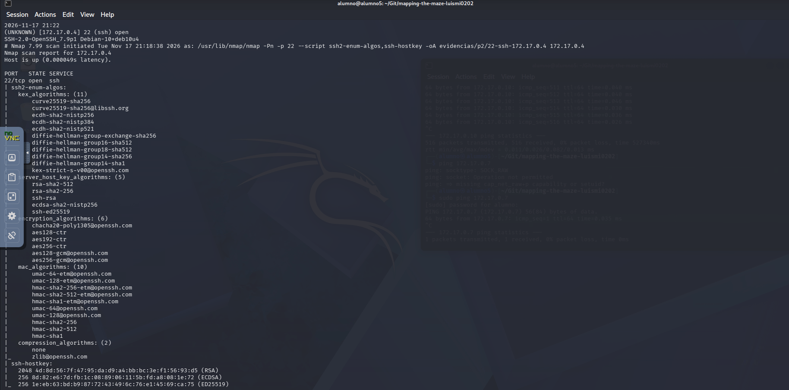

  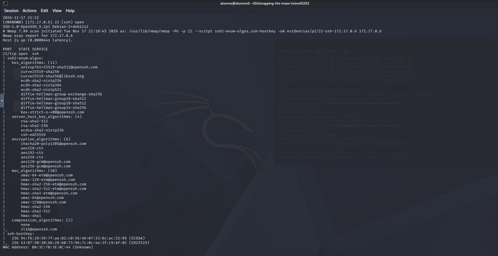

  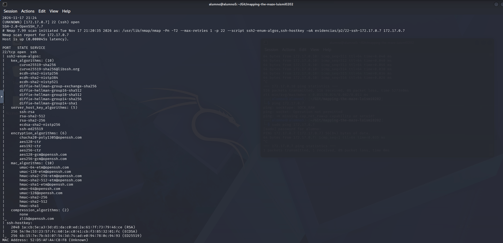

  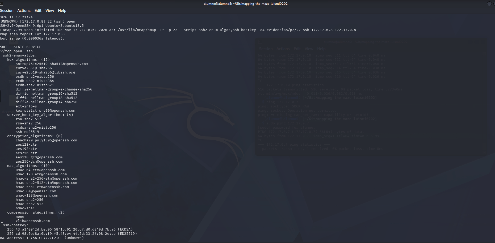

  
- **Siguiente paso:** leer los banners del FTP y de los puertos altos del broker.

### 2026-11-17 21:30 - Banners de FTP y de los puertos altos de ActiveMQ
- **Cuándo:** 2026-11-17 21:30
- **Objetivo y alcance:** leer lo que dicen solos al conectar 172.17.0.3:21, 172.17.0.5:61616 y
  172.17.0.5:38443, sin enviar datos. Dentro de 172.17.0.0/24 (scope.txt).
- **Qué hice:**
  `nc -nv -w 3 172.17.0.3 21 </dev/null 2>&1 | tee ../evidencias/luismi/p2/23-ftp-banner-172.17.0.3.txt`,
  `nc -nv -w 3 172.17.0.5 61616 </dev/null 2>&1 | strings | head -20 | tee ../evidencias/luismi/p2/23-banner-172.17.0.5-61616.txt` y
  `nc -nv -w 3 172.17.0.5 38443 </dev/null 2>&1 | tee ../evidencias/luismi/p2/23-banner-172.17.0.5-38443.txt`
- **Qué salió:**
  - **172.17.0.3:21 responde `220 (vsFTPd 2.3.4)`**: es la versión con puerta trasera conocida.
    Solo se leyó el banner. No se inició sesión ni se lanzó `ftp-vsftpd-backdoor`. Lo anoto como
    hallazgo grave y se lo aviso al profesor.
  - 172.17.0.5:61616 envía su `WireFormatInfo` con ProviderName `ActiveMQ`, PlatformDetails `Java`
    y ProviderVersion `5.15.15`.
  - 172.17.0.5:38443 acepta la conexión pero no envía nada.

  Evidencias: `../evidencias/luismi/p2/23-ftp-banner-172.17.0.3.txt`, `../evidencias/luismi/p2/23-banner-172.17.0.5-61616.txt`
  y `../evidencias/luismi/p2/23-banner-172.17.0.5-38443.txt`.
- **Captura:** 
- **Siguiente paso:** comprobar si el resto de puertos sin identificar envían saludo.

### 2026-11-17 21:31 - Puertos que no envían saludo
- **Cuándo:** 2026-11-17 21:31
- **Objetivo y alcance:** ver si 172.17.0.5:1883 (MQTT), 5672 (AMQP), 61613 (STOMP) y
  172.17.0.4:8009 (AJP) envían algún banner al conectar. Dentro de 172.17.0.0/24 (scope.txt).
- **Qué hice:**
  `for s in 172.17.0.5:1883 172.17.0.5:5672 172.17.0.5:61613 172.17.0.4:8009; do echo "##### $s #####"; nc -nv -w 3 ${s%:*} ${s#*:} </dev/null 2>&1 | strings | head -5; done | tee ../evidencias/luismi/p2/23-banner-sin-saludo.txt`
- **Qué salió:** los cuatro aceptan la conexión, pero ninguno envía datos: son protocolos en los
  que habla primero el cliente. No se les envió ninguna orden. Evidencia:
  `../evidencias/luismi/p2/23-banner-sin-saludo.txt`.
- **Captura:** 
- **Siguiente paso:** enumerar Samba y NetBIOS en 172.17.0.8.

### 2026-11-17 21:37 - SMB y NetBIOS en 172.17.0.8
- **Cuándo:** 2026-11-17 21:37 (nmap de 21:37:35 a 21:37:37)
- **Objetivo y alcance:** dialectos, firma SMB, nombre de equipo y grupo de trabajo de
  172.17.0.8, solo con negociación y sin abrir sesión. Dentro de 172.17.0.0/24 (scope.txt).
- **Qué hice:**
  `IP=172.17.0.8; sudo nmap -Pn -p 139,445 --script smb2-security-mode,smb-security-mode,smb-protocols $IP -oA ../evidencias/luismi/p2/24-smb-$IP; sudo nmap -Pn -sU -p 137 --script nbstat $IP -oA ../evidencias/luismi/p2/24-nbstat-$IP; nmblookup -A $IP | tee ../evidencias/luismi/p2/24-nmblookup-$IP.txt`.
  No usé `smb-os-discovery` (inicia sesión anónima), la sesión nula, `smb-enum-users` ni
  `smb-enum-shares`.
- **Qué salió:**
  - Dialectos SMB 2.0.2 a 3.1.1, sin SMBv1.
  - **Firma SMB habilitada pero no obligatoria.**
  - NetBIOS: equipo `SAMBASERVER`, grupo de trabajo `ESEEMEB.DL` (en la Parte 1 nmap lo mostró
    recortado como «DL») y explorador maestro (`__MSBROWSE__`).
  - NetBIOS user `<unknown>`: no aparece ningún usuario conectado.

  Evidencias: `../evidencias/luismi/p2/24-smb-172.17.0.8.nmap`, `../evidencias/luismi/p2/24-nbstat-172.17.0.8.nmap` y
  `../evidencias/luismi/p2/24-nmblookup-172.17.0.8.txt`.
- **Captura:** 
- **Siguiente paso:** enumerar IPMI en 172.17.0.10.

### 2026-11-17 21:42 - IPMI en 172.17.0.10
- **Cuándo:** 2026-11-17 21:42
- **Objetivo y alcance:** solo la versión y los métodos de autenticación de IPMI en
  172.17.0.10:623/udp. Dentro de 172.17.0.0/24 (scope.txt).
- **Qué hice:** `sudo nmap -Pn -sU -p 623 --script ipmi-version 172.17.0.10 -oA ../evidencias/luismi/p2/25-ipmi-172.17.0.10`
- **Qué salió:** **IPMI-2.0** (niveles 1.5 y 2.0). UserAuth `password, md5, md2, null`; PassAuth
  `auth_msg, auth_user, non_null_user`. No anuncia nombres de usuario. No se pidieron usuarios ni
  hashes. Evidencia: `../evidencias/luismi/p2/25-ipmi-172.17.0.10.nmap`.
- **Captura:** 
- **Siguiente paso:** intentar leer las propiedades del broker AMQP.

### 2026-11-17 21:44 - AMQP en 172.17.0.5
- **Cuándo:** 2026-11-17 21:44
- **Objetivo y alcance:** leer las propiedades que anuncia el broker en 172.17.0.5:5672, sin
  enviarle mensajes. Dentro de 172.17.0.0/24 (scope.txt).
- **Qué hice:** `sudo nmap -Pn -p 5672 --script amqp-info 172.17.0.5 -oA ../evidencias/luismi/p2/26-amqp-172.17.0.5`
- **Qué salió:** `ERROR: AQMP:handshake expected header (1) frame, but was 65`. El broker habla
  AMQP 1.0 y el script solo entiende AMQP 0-9-1, así que no se obtuvieron propiedades. No insistí
  con clientes de mensajería. La versión ya está confirmada por el puerto 61616 (5.15.15).
  Evidencia: `../evidencias/luismi/p2/26-amqp-172.17.0.5.nmap`.
- **Captura:** 
- **Siguiente paso:** buscar cuentas de usuario en todas las evidencias.

### 2026-11-17 21:46 - Búsqueda de cuentas de usuario
- **Cuándo:** 2026-11-17 21:46
- **Objetivo y alcance:** sacar de las evidencias de la Parte 2 lo que parezca un usuario o un
  correo. Solo se leen ficheros locales; no se envía tráfico.
- **Qué hice:**
  `grep -rhoiE "(user(name)?|login|owner|author|contact|admin)[^<]{0,60}|[a-z0-9._-]+@[a-z0-9.-]+" ../evidencias/luismi/p2/ | grep -viE "openssh\.com|libssh\.org" | sort -u | tee ../evidencias/luismi/p2/29-cuentas-candidatas.txt`;
  después, `grep -hE "<03>|<00>|<20>|User" ../evidencias/luismi/p2/24-nmblookup-172.17.0.8.txt ../evidencias/luismi/p2/24-nbstat-172.17.0.8.nmap`
  y `cat ../evidencias/luismi/p2/21-tls-cert-172.17.0.5-443.txt`.
- **Qué salió:** tras revisar la lista a mano, solo son cuentas reveladas por un servicio el correo
  `info@dockerlabs.lab` y el autor `Devcrud`, ambos en la web 172.17.0.5:443. Se descartan:
  - `ejemplo@correo.com`: es el texto de ejemplo del formulario.
  - `SAMBASERVER<03>`: es el nombre del equipo.
  - El grupo `ESEEMEB.DL`, el certificado genérico y los métodos de autenticación de IPMI.

  Evidencia: `../evidencias/luismi/p2/29-cuentas-candidatas.txt`.
- **Captura:** 
- **Siguiente paso:** guardar las evidencias en el repositorio y exportar el historial.

### 2026-11-17 21:47 - Evidencias subidas e historial exportado
- **Cuándo:** 2026-11-17 21:47 (subida a git) y 22:00 (historial)
- **Objetivo y alcance:** dejar en el repositorio las evidencias de la Parte 2 y el historial con
  fecha. Comandos locales y de git; no tocan la red del cliente.
- **Qué hice:** `git add .`, `git commit -m "Añadidas evidencias de la parte 2"` y `git push`.
  Después exporté el historial quitando las órdenes sin interés:
  `fc -li 1 | grep -vE '^ *[0-9]+ +[0-9-]+ +[0-9:]+ +(cd|ls|clear|cap|less|nano|xdgopen|fc|history|exit)( |$)' | awk '$2 >= "2026-11-17"' > ../evidencias/luismi/p2/historial-comandos.txt`
  y lo comprobé con `wc -l ../evidencias/luismi/p2/historial-comandos.txt`.
- **Qué salió:** evidencias subidas a GitHub. El primer intento
  de exportar se lanzó con el texto literal `"AAAA-MM-DD"` de la guía y dio un fichero vacío (0
  líneas); repetido con la fecha real `2026-11-17`, el historial quedó con **126 líneas**: todos los
  comandos de las Partes 0 a 2 con su hora. Es la fuente de esta parte del cuaderno. El
  2026-11-18 se dejaron en él solo los comandos de la Parte 2 (ver «Historiales separados por
  parte», en la Parte 4).
- **Captura:** 
- **Siguiente paso:** pasar los resultados a `inventario.md` (Parte 2) y empezar la Parte 3.

### Vigilancia durante la Parte 2
- **Cuándo:** 2026-11-17, mientras se lanzaban los comandos anteriores. Se ve al fondo de las
  capturas p2-02, p2-05, p2-06, p2-07, p2-08 y p2-10. Se hizo en otra terminal y no aparece en el
  historial exportado.
- **Objetivo y alcance:** comprobar que 172.17.0.10 (consola IPMI, posible equipo frágil) y
  172.17.0.7 (equipo delicado más probable) seguían respondiendo.
- **Qué hice:** `ping 172.17.0.10` en una segunda terminal. Para 172.17.0.7, `ping 172.17.0.7`
  falló por falta de permisos (`Operation not permitted`) y lo repetí con `sudo ping 172.17.0.7`.
- **Qué salió:** 172.17.0.10: **516 paquetes enviados, 516 recibidos, 0 % de pérdida**.
  172.17.0.7: 1 enviado, 1 recibido. Ningún equipo se degradó.
- **Captura:** se ve al fondo de la captura de SMB:
  
- **Siguiente paso:** Parte 3.

### Resumen de la Parte 2
- Versiones confirmadas por banner: vsftpd 2.3.4, ActiveMQ 5.15.15 y todos los OpenSSH con su
  paquete de distribución.
- Software nuevo identificado: **Jenkins 2.441** en 172.17.0.6:8080.
- Debilidades de configuración: certificado autofirmado y caducado (172.17.0.5:443), firma SMB no
  obligatoria (172.17.0.8), IPMI 2.0 con autenticación `null` anunciada (172.17.0.10), `TRACE`
  activo (172.17.0.5:61614), MQTT que acepta conexiones sin credenciales (172.17.0.5:1883) y
  algoritmos SSH con SHA-1.
- Cuentas reveladas: `info@dockerlabs.lab` y `Devcrud` (web de 172.17.0.5).
- Entregable: [inventario.md](../inventario.md), apartado Parte 2.

---

## Parte 3 - De la versión al CVE

Criterio de toda la parte: solo consultas. El script `vulners` de nmap compara la versión detectada
con su base de datos y no prueba el fallo; `searchsploit` solo lista (no se usa `-m` ni se abre
ningún exploit); NVD y los trackers de Debian y Ubuntu son webs públicas que no tocan la red del
cliente. Prohibido y no usado: `--script vuln`, Metasploit, nuclei y escáneres de vulnerabilidades.
Al equipo delicado (172.17.0.7) no se le lanza `vulners`: sus versiones se buscan en NVD con los
datos de la Parte 1. Las horas y los comandos salen de `../evidencias/luismi/p3/historial-comandos.txt`.

### 2026-11-17 22:01 - Historial de la Parte 2 subido
- **Cuándo:** 2026-11-17 22:01 (subida a git) y 22:09 (sincronización)
- **Objetivo y alcance:** dejar en el repositorio el historial de la Parte 2 antes de empezar la
  Parte 3. Comandos locales y de git; no tocan la red del cliente.
- **Qué hice:** `git pull`, `git add .`, `git commit -m "Añadido historial comandos parte 2"`,
  `git push` y, a las 22:09, `git pull`.
- **Qué salió:** el primer `git commit` quedó con las comillas sin cerrar y se repitió bien escrito
  en el siguiente comando. Quedó subido `../evidencias/luismi/p2/historial-comandos.txt` (126 líneas).
- **Captura:** sin captura.
- **Siguiente paso:** reunir en un fichero los productos y versiones que hay que investigar.

### 2026-11-17 22:17 - Lista de productos y versiones
- **Cuándo:** 2026-11-17 22:17 (lista automática) y 22:24 (añadidos a mano y comprobación)
- **Objetivo y alcance:** partir de una lista única de servicios con versión de los equipos de
  172.17.0.0/24 (scope.txt). Solo lee ficheros de la Parte 1; no envía tráfico.
- **Qué hice:**
  `grep -hE "^[0-9]+/(tcp|udp) +open " ../evidencias/luismi/p1/11-tcp-ver-*.nmap ../evidencias/luismi/p1/12-udp-*.nmap | awk '{ $2=""; print }' | sort -u | tee ../evidencias/luismi/p3/30-versiones.txt`
  Después añadí las dos versiones confirmadas en la Parte 2:
  `echo "61616/tcp activemq ProviderVersion 5.15.15 (confirmado por WireFormatInfo, Parte 2)" >> ../evidencias/luismi/p3/30-versiones.txt`
  `echo "21/tcp ftp vsFTPd 2.3.4 (confirmado por banner 220, Parte 2)" >> ../evidencias/luismi/p3/30-versiones.txt`
  y lo revisé con `cat ../evidencias/luismi/p3/30-versiones.txt`.
- **Qué salió:** 27 líneas. Productos con versión: vsftpd 2.3.4; OpenSSH 7.7, 7.9p1 Debian
  10+deb10u4, 9.2p1 Debian 2+deb12u2, 9.2p1 Debian 2+deb12u10 y 9.6p1 Ubuntu 3ubuntu13.5; Apache
  httpd 2.4.58 (Ubuntu), 2.4.59 (Debian) y 2.4.68 (Debian); Apache Tomcat 9.0.30; Jetty
  9.4.39.v20210325 y 10.0.18; ActiveMQ OpenWire 5.15.15; Samba smbd 4; SimpleHTTPServer 0.6 (Python
  3.11.2). Sin versión: mqtt (1883), amqp? (5672), stomp (61613), tcpwrapped (38443) y asf-rmcp
  (623/udp). Evidencia: `../evidencias/luismi/p3/30-versiones.txt`.
- **Captura:** 
  La captura se rehízo el 2026-11-18 a las 00:01, así que ya muestra al final las dos líneas
  añadidas después para Jenkins e IPMI (entrada del 2026-11-18 00:01).
- **Siguiente paso:** buscar candidatos automáticos con `vulners` en todos los equipos menos el
  delicado.

### 2026-11-17 22:36 - Candidatos automáticos con vulners
- **Cuándo:** 2026-11-17 22:36 (bucle) y 22:38 (recuento)
- **Objetivo y alcance:** obtener los CVE asociados a cada versión en los equipos vivos de
  172.17.0.0/24 (scope.txt) excepto 172.17.0.7, solo en sus puertos TCP abiertos. `vulners` es de
  las categorías safe, vuln y external: consulta una base de datos y no prueba el fallo.
- **Qué hice:**
  `export FRAGIL=172.17.0.7`
  `for ip in $(grep -vx "$FRAGIL" ../evidencias/luismi/p1/vivos.txt); do ports=$(grep -oE '[0-9]+/open/tcp' ../evidencias/luismi/p1/10-tcp-all-$ip.gnmap | cut -d/ -f1 | paste -sd, -); [ -z "$ports" ] && continue; echo "=== $ip : $ports ==="; sudo nmap -Pn -sV -p $ports --script vulners --script-args mincvss=5.0 -oA ../evidencias/luismi/p3/31-vulners-$ip $ip; done`
  y conté las líneas con CVE: `grep -c "CVE-" ../evidencias/luismi/p3/31-vulners-*.nmap`
- **Qué salió:** líneas con CVE por equipo: .3 = 123, .4 = 155, .5 = 287, .6 = 26, .8 = 329,
  .9 = 68 y .10 = 0 (su único puerto TCP, SimpleHTTPServer, no trae ninguno). En la .8, la mayoría
  vienen de «Samba smbd 4», una versión demasiado vaga para evaluarlos. Al usar `-sV`, nmap lanzó
  por su cuenta los scripts de versión `mqtt-subscribe` (1883) y `amqp-info` (5672) en la .5: el
  primero devolvió dos temas de aviso de ActiveMQ sin contenido y el segundo el mismo error de
  negociación que en la Parte 2. Lo dejo anotado en el registro. Evidencias:
  `../evidencias/luismi/p3/31-vulners-<IP>.nmap`, `.xml` y `.gnmap`.
- **Captura:** sin captura (las capturas por equipo se hicieron a las 22:47, entrada siguiente).
- **Siguiente paso:** buscar en Exploit-DB si hay código público para estas versiones.

### 2026-11-17 22:39 - Búsqueda en Exploit-DB con searchsploit
- **Cuándo:** 2026-11-17 22:39 (búsqueda) y 22:53 (revisión del fichero)
- **Objetivo y alcance:** saber si existe código público para cada producto, como dato para la
  prioridad. Búsqueda local en la copia de Exploit-DB de Kali; no toca la red del cliente.
- **Qué hice:**
  `for t in "vsftpd 2.3.4" "ActiveMQ" "Tomcat 9.0" "Jetty 9.4" "Jetty 10.0" "OpenSSH 7.7" "OpenSSH 7.9" "Apache 2.4.5" "Samba 4"; do echo "##### $t #####"; searchsploit "$t"; done | tee ../evidencias/luismi/p3/32-searchsploit.txt`
  y lo revisé con `cat ../evidencias/luismi/p3/32-searchsploit.txt`.
- **Qué salió:** hay entradas para vsftpd 2.3.4 («Backdoor Command Execution», 49757.py y
  17491.rb) y para OpenSSH anterior a 7.7 o 7.7 («Username Enumeration», 45233.py, 45210.py y
  45939.py). Para ActiveMQ, Tomcat 9.0, Jetty 9.4, Apache 2.4.5 y Samba solo salen versiones
  distintas de las observadas; Jetty 10.0 y OpenSSH 7.9 no dan resultados. Solo se listó: no se
  abrió ni se copió nada. Evidencia: `../evidencias/luismi/p3/32-searchsploit.txt`.
- **Captura:** 
- **Siguiente paso:** preparar en pantalla las líneas de CVE de cada equipo para capturarlas.

### 2026-11-17 22:40 - Capturas de vulners por equipo
- **Cuándo:** 2026-11-17 22:40 (prueba con la .3) y 22:47 (bucle con todos)
- **Objetivo y alcance:** mostrar los puertos y los primeros CVE de cada equipo para la captura.
  Solo lee los ficheros de la entrada de las 22:36; no envía tráfico.
- **Qué hice:** primero `grep -E "CVE-|^[0-9]+/tcp" ../evidencias/luismi/p3/31-vulners-172.17.0.3.nmap | head -30`
  y después, con pausa para cada captura:
  `for ip in 172.17.0.3 172.17.0.4 172.17.0.5 172.17.0.6 172.17.0.8 172.17.0.9 172.17.0.10; do clear; date "+%F %H:%M"; echo "##### vulners $ip  ->  captura: p3-01-vulners-$ip.png #####"; grep -E "^[0-9]+/tcp|CVE-" ../evidencias/luismi/p3/31-vulners-$ip.nmap | grep -v "MEND:" | head -30; read -k1 "?--- Haz la captura y pulsa una tecla para el siguiente ---"; done`
- **Qué salió:** una pantalla por equipo con sus puertos y los CVE de mayor puntuación (quité las
  líneas `MEND:`, que repiten los mismos CVE desde otra base de datos). Candidatos que pasan a revisión: CVE-2011-2523 (.3),
  CVE-2020-1938, CVE-2025-24813 y CVE-2024-50379 (.4), CVE-2023-46604 y CVE-2022-41678 (.5),
  CVE-2024-6387 (.6, .8 y .9), CVE-2023-48795 y CVE-2023-38408 (.4, .6 y .9) y CVE-2024-38476 (.3,
  .5 y .8). CVE-2021-34429 (Jetty 9.4.39 de la .5) se añadió en la revisión manual. La .10 sale vacía.
- **Captura:**
  
  
  
  
  
  
  
- **Siguiente paso:** buscar a mano en NVD los CVE de OpenSSH 7.7, la versión del equipo delicado.

### 2026-11-17 22:54 - CVE de OpenSSH 7.7 (172.17.0.7) consultados en NVD
- **Cuándo:** 2026-11-17 22:54
- **Objetivo y alcance:** obtener los CVE de la versión de SSH de 172.17.0.7 sin enviarle ningún
  paquete, como pide la guía para el equipo delicado. Consulta a la API pública de NVD; no toca la
  red del cliente.
- **Qué hice:**
  `curl -s "https://services.nvd.nist.gov/rest/json/cves/2.0?virtualMatchString=cpe:2.3:a:openbsd:openssh:7.7" -o ../evidencias/luismi/p3/31-nvd-openssh-7.7-172.17.0.7.json`
  `jq -r '.vulnerabilities[].cve | [.id, ((.metrics.cvssMetricV31 // .metrics.cvssMetricV30 // .metrics.cvssMetricV2)[0].cvssData.baseScore // "n/d")] | @tsv' ../evidencias/luismi/p3/31-nvd-openssh-7.7-172.17.0.7.json | sort -k2 -rn | tee ../evidencias/luismi/p3/31-nvd-openssh-7.7-172.17.0.7.txt`
- **Qué salió:** 42 CVE ordenados por puntuación, del CVE-2023-38408 (9.8) al CVE-2026-106553
  (2.2). Entre ellos están CVE-2023-48795 (5.9) y CVE-2018-15473 (5.3), que pasan a revisión.
  Evidencias: `../evidencias/luismi/p3/31-nvd-openssh-7.7-172.17.0.7.json` y `.txt`.
- **Captura:** 
- **Siguiente paso:** subir las evidencias y revisar cada candidato en su ficha de NVD.

### 2026-11-17 22:57 - Evidencias de vulners subidas
- **Cuándo:** 2026-11-17 22:57
- **Objetivo y alcance:** guardar en el repositorio las salidas de las entradas anteriores. Git; no
  toca la red del cliente.
- **Qué hice:** `git add .`, `git commit -m "Añadido vulners"` y `git push`
- **Qué salió:** subidos `30-versiones.txt`, las salidas `31-vulners-*`, la consulta
  NVD de la .7 y `32-searchsploit.txt`.
- **Captura:** sin captura.
- **Siguiente paso:** descargar la ficha NVD de cada candidato.

### 2026-11-17 23:04 - Fichas NVD de los 12 candidatos
- **Cuándo:** 2026-11-17 23:04
- **Objetivo y alcance:** confirmar para cada candidato su CWE, su descripción y el rango exacto de
  versiones afectadas. Consulta a la API pública de NVD; no toca la red del cliente.
- **Qué hice:**
  `for CVE in CVE-2011-2523 CVE-2023-46604 CVE-2020-1938 CVE-2025-24813 CVE-2024-50379 CVE-2022-41678 CVE-2021-34429 CVE-2018-15473 CVE-2024-6387 CVE-2023-48795 CVE-2023-38408 CVE-2024-38476; do clear; date "+%F %H:%M"; curl -s "https://services.nvd.nist.gov/rest/json/cves/2.0?cveId=$CVE" -o ../evidencias/luismi/p3/33-nvd-$CVE.json; echo "##### captura: p3-03-nvd-$CVE.png #####"; jq -r '.vulnerabilities[0].cve | "\(.id)\nCWE: \([.weaknesses[]?.description[]?.value]|unique|join(", "))\n\(.descriptions[]|select(.lang=="en").value)"' ../evidencias/luismi/p3/33-nvd-$CVE.json | fold -s -w 110; echo "--- Versiones afectadas ---"; jq -r '.vulnerabilities[0].cve.configurations[]?.nodes[]?.cpeMatch[]? | select(.vulnerable) | "\(.criteria)  desde:\(.versionStartIncluding // "-")  hasta(sin incluir):\(.versionEndExcluding // "-")  hasta(incl):\(.versionEndIncluding // "-")"' ../evidencias/luismi/p3/33-nvd-$CVE.json | head -12; read -k1 "?--- Haz la captura y pulsa una tecla ---"; sleep 6; done`
  El `sleep 6` deja tiempo entre peticiones porque NVD limita las consultas.
- **Qué salió:** las 12 fichas descargadas. CWE y rango frente a la versión observada:
  - CVE-2011-2523: CWE-78; solo vsftpd 2.3.4, la versión de la .3.
  - CVE-2023-46604: CWE-502; ActiveMQ anterior a 5.15.16; la .5 tiene 5.15.15.
  - CVE-2020-1938: NVD-CWE-Other; Tomcat de 9.0.0 a anterior a 9.0.31; la .4 tiene 9.0.30.
  - CVE-2025-24813: CWE-44, CWE-502 y CWE-706; Tomcat anterior a 9.0.99.
  - CVE-2024-50379: CWE-367; Tomcat de 9.0.0 a anterior a 9.0.98.
  - CVE-2022-41678: CWE-287; ActiveMQ anterior a 5.16.6.
  - CVE-2021-34429: CWE-200, CWE-551 y NVD-CWE-Other; Jetty de 9.4.37 a anterior a 9.4.43 (la .5
    tiene 9.4.39) y de 10.0.1 a anterior a 10.0.6 (la .6, con 10.0.18, queda fuera).
  - CVE-2018-15473: CWE-362; OpenSSH hasta la 7.7 incluida.
  - CVE-2024-6387: CWE-362 y CWE-364; el rango no se ve completo en esta salida (entrada siguiente).
  - CVE-2023-48795: CWE-354; OpenSSH anterior a 9.6.
  - CVE-2023-38408: CWE-428; OpenSSH anterior a 9.3p2; afecta a `ssh-agent`, no al servidor.
  - CVE-2024-38476: CWE-829 y NVD-CWE-noinfo; Apache httpd de 2.4.0 a anterior a 2.4.60.

  Evidencias: `../evidencias/luismi/p3/33-nvd-<CVE>.json`.
- **Captura:**
  
  
  
  
  
  
  
  
  
  
  
  
- **Siguiente paso:** sacar el rango completo de OpenSSH afectado por CVE-2024-6387.

### 2026-11-17 23:15 - Rango de versiones de CVE-2024-6387
- **Cuándo:** 2026-11-17 23:15 y 23:16
- **Objetivo y alcance:** ver solo las entradas de OpenSSH del CVE, porque la ficha mezcla muchos
  productos de otros fabricantes y la salida anterior se cortaba en 12 líneas. Solo lee el JSON ya
  descargado.
- **Qué hice:** primero
  `jq -r '.vulnerabilities[0].cve.configurations[]?.nodes[]?.cpeMatch[]? | select(.vulnerable) | select(.criteria|test("openssh")) | "\(.criteria) desde:\(.versionStartIncluding // "-") hasta(sin incluir):\(.versionEndExcluding // "-")"' ../evidencias/luismi/p3/33-nvd-CVE-2024-6387.json`
  y lo repetí añadiendo el campo `hasta(incl):\(.versionEndIncluding // "-")`.
- **Qué salió:** el primer intento no mostraba el límite superior del tramo que empieza en 8.6,
  porque NVD lo guarda como «hasta incluida»; por eso lo repetí con ese campo. Rango completo:
  anteriores a 4.4, la 4.4, la 8.5p1 y de 8.6 a 9.8 incluida. Entran la .6 y la .9 (9.2p1) y la .8
  (9.6p1); quedan fuera la .4 (7.9p1) y la .7 (7.7). Evidencia: `../evidencias/luismi/p3/33-nvd-CVE-2024-6387.json`.
- **Captura:** 
- **Siguiente paso:** anotar la decisión provisional de cada CVE.

### 2026-11-17 23:18 - Notas de decisión por CVE
- **Cuándo:** 2026-11-17 23:18
- **Objetivo y alcance:** aplicar las cuatro preguntas de la guía (rango, backport, identificación
  fiable y configuración) y dejar por escrito la decisión de cada candidato. Fichero local.
- **Qué hice:** escribí la tabla con `cat > ../evidencias/luismi/p3/notas-cve.txt <<'FIN' ... FIN` y la
  revisé con `cat ../evidencias/luismi/p3/notas-cve.txt`.
- **Qué salió:** se quedan CVE-2011-2523, CVE-2023-46604, CVE-2020-1938, CVE-2021-34429 y
  CVE-2018-15473. Quedan a la espera del backport CVE-2024-6387, CVE-2023-48795 y CVE-2024-38476
  (este último también de la configuración). Pendientes de configuración: CVE-2022-41678 (requiere
  autenticación) y CVE-2025-24813 (escritura activada, no estándar). Descartes: CVE-2024-50379 (solo
  sistemas de ficheros que no distinguen mayúsculas), CVE-2023-38408 (afecta al cliente) y los CVE
  de «Samba 4» en bloque (versión imprecisa). La CWE-284 de CVE-2020-1938 es elección propia,
  porque NVD da NVD-CWE-Other. Evidencia: `../evidencias/luismi/p3/notas-cve.txt`.
- **Captura:** sin captura.
- **Siguiente paso:** comprobar los backports en los trackers de Debian y Ubuntu.

### 2026-11-17 23:30 - Backports en los trackers de Debian y Ubuntu
- **Cuándo:** 2026-11-17, hacia las 23:30 - 23:34. No hay comando en el historial porque se hizo en
  el navegador; la hora sale de las capturas (00:30 - 00:34 en el reloj del ordenador, que va una
  hora por delante del Kali, igual que en el resto de capturas de esta parte).
- **Objetivo y alcance:** ver si Debian o Ubuntu ya han corregido el fallo en la revisión del
  paquete que muestra cada banner. Webs públicas (security-tracker.debian.org y
  ubuntu.com/security); no tocan la red del cliente.
- **Qué hice:** abrí en el navegador las páginas de CVE-2024-6387 (Debian y Ubuntu), CVE-2023-48795
  (Debian) y CVE-2024-38476 (Debian y Ubuntu), y comparé la versión «fixed» con la de cada banner.
- **Qué salió:**
  - CVE-2024-6387: Debian bookworm lo corrige en `1:9.2p1-2+deb12u3` (DSA-5724-1). La .6 tiene
    `deb12u2`, anterior: **se queda**. La .9 tiene `deb12u10`: descartada por backport. Ubuntu 24.04
    lo corrige en `1:9.6p1-3ubuntu13.3`; la .8 tiene `3ubuntu13.5`: descartada.
  - CVE-2023-48795: Debian lo corrige en `1:7.9p1-10+deb10u4` (buster, DLA-3694-1) y en
    `1:9.2p1-2+deb12u2` (bookworm, DSA-5586-1). La .4, la .6 y la .9 tienen esa revisión o una
    posterior: descartadas. En la .7 (OpenSSH 7.7 sin distribución) **se queda**.
  - CVE-2024-38476: Debian bookworm lo corrige en `2.4.61-1~deb12u1` (DSA-5729-1); la .5 tiene
    2.4.59: **se queda**. Ubuntu 24.04 lo corrige en `2.4.58-1ubuntu8.2`; el banner de la .3 y la .8
    no muestra la revisión, así que no se puede saber: queda pendiente, igual que la condición de
    proxy.
- **Captura:**
  
  
  
  
  
- **Siguiente paso:** subir las fichas NVD y las notas.

### 2026-11-17 23:41 - Fichas NVD y notas subidas
- **Cuándo:** 2026-11-17 23:41
- **Objetivo y alcance:** guardar en el repositorio las fichas NVD y las notas de decisión. Git; no
  toca la red del cliente.
- **Qué hice:** `git add .`, `git commit -m "Añadidos notas cve y cves parte 3"` y `git push`
- **Qué salió:** subidos los 12 `33-nvd-CVE-*.json` y `notas-cve.txt`.
- **Captura:** sin captura.
- **Siguiente paso:** exportar el historial de comandos de la Parte 3.

### 2026-11-17 23:42 - Historial de la Parte 3 exportado
- **Cuándo:** 2026-11-17 23:42
- **Objetivo y alcance:** guardar los comandos de la Parte 3 con su fecha y hora. Comandos
  locales; no tocan la red del cliente.
- **Qué hice:** exporté el historial con `fc -li`, quitando las órdenes sin interés (cd, ls, clear,
  nano...), lo comprobé con `wc -l ../evidencias/luismi/p3/historial-comandos.txt`, lo revisé en `nano` y lo
  subí a git.
- **Qué salió:** `../evidencias/luismi/p3/historial-comandos.txt` subido (156 líneas, del
  2026-11-17 15:03 al 23:42), con fecha y hora de cada comando. El 2026-11-18 se dejaron en él
  solo los comandos de la Parte 3, incluidos los de Jenkins e IPMI de las 00:00 a las 00:05 (ver
  «Historiales separados por parte», en la Parte 4). Es la fuente de esta parte del
  cuaderno.
- **Captura:** 
- **Siguiente paso:** revisar los dos productos que `vulners` no podía cubrir: Jenkins 2.441 (.6) e
  IPMI 2.0 (.10).

### 2026-11-18 00:01 - Versiones que faltaban: Jenkins e IPMI
- **Cuándo:** 2026-11-18 00:01. Comandos posteriores a la primera exportación del historial; están
  en `../evidencias/luismi/p3/historial-comandos.txt` (comandos 203 a 221) desde la separación por partes.
- **Objetivo y alcance:** añadir a la lista dos productos con versión conocida de la Parte 2 que no
  estaban en ella: Jenkins 2.441 en 172.17.0.6:8080 (nmap `-sV` solo veía «Jetty 10.0.18») e IPMI
  2.0 en 172.17.0.10:623/udp (`vulners` solo revisa TCP). Ambos dentro de 172.17.0.0/24
  (scope.txt). Solo se escribe en un fichero local; no envía tráfico.
- **Qué hice:**
  `echo "8080/tcp http Jenkins 2.441 (cabecera X-Jenkins, Parte 2)" >> ../evidencias/luismi/p3/30-versiones.txt`
  `echo "623/udp asf-rmcp IPMI 2.0, UserAuth con null (ipmi-version, Parte 2)" >> ../evidencias/luismi/p3/30-versiones.txt`
  y lo revisé con `cat ../evidencias/luismi/p3/30-versiones.txt`.
- **Qué salió:** la lista termina con las dos líneas nuevas. La línea de IPMI quedó escrita cuatro
  veces en el fichero al repetir el `echo`; la captura se tomó antes y muestra una sola. Evidencia:
  `../evidencias/luismi/p3/30-versiones.txt`.
- **Captura:** 
- **Siguiente paso:** buscar Jenkins 2.441 en Exploit-DB.

### 2026-11-18 00:02 - searchsploit de Jenkins 2.441
- **Cuándo:** 2026-11-18 00:02
- **Objetivo y alcance:** saber si hay código público para Jenkins 2.441, como dato para la
  prioridad. Búsqueda local en Kali; no toca la red del cliente.
- **Qué hice:** `clear; date "+%F %H:%M"; echo "##### Jenkins 2.441 #####"; searchsploit "Jenkins 2.441" | tee -a ../evidencias/luismi/p3/32-searchsploit.txt`
- **Qué salió:** una entrada, «Jenkins 2.441 - Local File Inclusion» (`java/webapps/51993.py`). Solo
  se listó; no se abrió ni se copió. El bloque quedó añadido dos veces al final de
  `../evidencias/luismi/p3/32-searchsploit.txt` al repetir el comando, y sin la línea de título, porque el
  `echo` no pasa por `tee`.
- **Captura:** 
- **Siguiente paso:** descargar la ficha NVD del CVE de Jenkins.

### 2026-11-18 00:02 - Ficha NVD de CVE-2024-23897 (Jenkins)
- **Cuándo:** 2026-11-18 00:02
- **Objetivo y alcance:** confirmar CWE, descripción y rango de versiones del CVE de la CLI de
  Jenkins. Consulta a la API pública de NVD; no toca la red del cliente.
- **Qué hice:** `CVE=CVE-2024-23897`, `curl -s "https://services.nvd.nist.gov/rest/json/cves/2.0?cveId=$CVE" -o ../evidencias/luismi/p3/33-nvd-$CVE.json`
  y los mismos dos `jq` de la entrada de las 23:04 (CWE y descripción; versiones afectadas).
- **Qué salió:** CWE-22 y CWE-27. Jenkins 2.441 y anteriores (y LTS 2.426.2 y anteriores) permiten
  a un atacante sin autenticar leer ficheros del servidor a través de la CLI. Rango: Jenkins
  anterior a 2.442 y LTS anterior a 2.426.3. La 2.441 de la .6 entra; no hay paquete de
  distribución, así que no hay backport. **Se queda** como V-08. Evidencia:
  `../evidencias/luismi/p3/33-nvd-CVE-2024-23897.json`.
- **Captura:** 
- **Siguiente paso:** hacer lo mismo con el candidato de IPMI 2.0.

### 2026-11-18 00:04 - Ficha NVD de CVE-2013-4786 (IPMI 2.0)
- **Cuándo:** 2026-11-18 00:04
- **Objetivo y alcance:** comprobar el fallo de RAKP de IPMI 2.0 para 172.17.0.10. Consulta a la
  API pública de NVD; no toca la red del cliente. No se lanzó `ipmi-dumphashes` ni nada parecido,
  porque eso sería explotar el fallo.
- **Qué hice:** `CVE=CVE-2013-4786`, el mismo `curl` y los mismos `jq` que en la entrada anterior.
- **Qué salió:** CWE-255. La especificación IPMI 2.0 admite RAKP, y la respuesta del BMC (mensaje
  2) permite obtener el hash de la contraseña y atacarlo sin conexión. NVD lo asocia a
  `intel:intelligent_platform_management_interface:2.0` y a un firmware de Fujitsu, no a versiones
  de un fabricante concreto. La .10 anuncia IPMI 2.0, pero no se conocen ni el fabricante ni el
  firmware, y el ataque necesita un usuario válido: **pendiente de confirmar** (V-12). Evidencia:
  `../evidencias/luismi/p3/33-nvd-CVE-2013-4786.json`.
- **Captura:** 
- **Siguiente paso:** pasar todo a `registro-vulns.md`: fichas, pendientes y descartes.

### Resumen de la Parte 3
- Hallazgos con sospecha fundada (V-01 a V-08): puerta trasera de vsftpd 2.3.4 (.3,
  CVE-2011-2523), ejecución remota en ActiveMQ 5.15.15 (.5, CVE-2023-46604), Ghostcat en Tomcat
  9.0.30 con AJP expuesto (.4, CVE-2020-1938), regreSSHion en OpenSSH `deb12u2` (.6,
  CVE-2024-6387), WEB-INF en Jetty 9.4.39 (.5, CVE-2021-34429), enumeración de usuarios (.7,
  CVE-2018-15473), Terrapin (.7, CVE-2023-48795) y lectura de ficheros por la CLI de Jenkins
  2.441 (.6, CVE-2024-23897).
- Pendientes de la configuración o de identificar mejor el equipo (V-09 a V-12): Jolokia con
  autenticación (.5, CVE-2022-41678), PUT parcial en Tomcat (.4, CVE-2025-24813), Apache como proxy
  (.3, .5 y .8, CVE-2024-38476) e IPMI 2.0 con RAKP (.10, CVE-2013-4786).
- Descartados: backports de Debian y Ubuntu (CVE-2024-6387 en .8 y .9; CVE-2023-48795 en .4, .6 y
  .9), versiones fuera de rango, CVE-2024-50379 (solo Windows), CVE-2023-38408 (cliente) y los CVE
  de «Samba 4» por versión imprecisa.
- Ningún exploit, ningún `--script vuln`, ningún Metasploit. El equipo delicado solo se revisó en NVD.
- Entregable: [registro-vulns.md](../registro-vulns.md).

---

## Parte 4 - Priorizar e informar

Criterio de toda la parte: no se envía ningún paquete a la red del cliente. Solo se consultan
fuentes públicas (NVD, FIRST EPSS y CISA KEV) y se trabaja sobre las evidencias de las Partes 1
a 3. Los datos se usan para ordenar los 12 hallazgos del registro con un método escrito, no solo
por CVSS.

**Sobre las horas y los comandos de esta parte:** salen de `../evidencias/luismi/p4/historial-comandos.txt`
(historial de zsh con fecha y hora). Las entradas que no corresponden a un comando (priorización,
revisión del inventario e informe) son trabajo de redacción y solo llevan la fecha.

### 2026-11-18 00:12 - Lista de CVE y fecha de consulta
- **Cuándo:** 2026-11-18 00:12, justo después de un `git pull`.
- **Objetivo y alcance:** tener en un fichero la lista de CVE a puntuar y la fecha de las
  consultas, para citarla en el registro y en el informe. Comandos locales sobre
  `registro-vulns.md`; no tocan la red del cliente.
- **Qué hice:**
  `grep -oE "CVE-[0-9]{4}-[0-9]+" registro-vulns.md | sort -u | tee ../evidencias/luismi/p4/39-cves.txt`
  y `date "+%F" | tee ../evidencias/luismi/p4/fecha-consulta.txt`.
- **Qué salió:** 14 CVE: los 12 de las fichas V-01 a V-12 y los 2 descartados en la Parte 3
  (CVE-2023-38408 y CVE-2024-50379), porque la extracción recoge también la tabla de descartados.
  Se dejaron en la lista para documentar sus datos, pero no entran en el orden de prioridad
  (anotado en el apartado «Datos no disponibles» del registro). Fecha de consulta: 2026-11-18.
  Evidencias: `../evidencias/luismi/p4/39-cves.txt` y `../evidencias/luismi/p4/fecha-consulta.txt`.
- **Captura:** sin captura; la lista se ve en la primera línea de la captura de EPSS.
- **Siguiente paso:** sacar el CVSS de cada CVE.

### 2026-11-18 00:13 - CVSS de cada CVE (NVD)
- **Cuándo:** 2026-11-18 00:13 (primer intento) y 00:14 (versión que queda en evidencias y
  revisión con `cat`).
- **Objetivo y alcance:** obtener la versión de CVSS, la puntuación, la gravedad, el vector y quién
  la publica. Se leen las fichas de NVD descargadas en la Parte 3
  (`../evidencias/luismi/p3/33-nvd-CVE-*.json`); no se toca la red del cliente.
- **Qué hice:**
  1. A las 00:13, el bucle de la guía que descarga de NVD solo las fichas que faltaran
     (`for CVE in $(cat ../evidencias/luismi/p4/39-cves.txt); do [ -f ../evidencias/luismi/p3/33-nvd-$CVE.json ] || { curl -s "https://services.nvd.nist.gov/rest/json/cves/2.0?cveId=$CVE" -o ../evidencias/luismi/p3/33-nvd-$CVE.json; sleep 6; }; done`).
     Las 14 ya estaban de la Parte 3, así que no descargó ninguna.
  2. También a las 00:13, el bucle de puntuación de la guía, copiado en varias líneas (con
     `| tee ../evidencias/luismi/p4/40-cvss.txt`).
  3. A las 00:14 lo sustituí por una versión en una sola línea que, si hay varias métricas, toma
     la de NVD (`Primary`) y añade quién la publica (`source`). Su salida sobrescribió la del
     intento anterior:
     `for CVE in $(cat ../evidencias/luismi/p4/39-cves.txt); do jq -r --arg c "$CVE" '.vulnerabilities[0].cve.metrics | (.cvssMetricV31 // .cvssMetricV30 // .cvssMetricV40 // .cvssMetricV2 // [{}]) | (map(select(.type=="Primary"))[0] // .[0]) | "\($c) | v\(.cvssData.version // "n/d") | \(.cvssData.baseScore // "n/d") \(.cvssData.baseSeverity // .baseSeverity // "") | \(.cvssData.vectorString // "sin vector") | fuente: \(.source // "n/d")"' "../evidencias/luismi/p3/33-nvd-$CVE.json"; done | tee ../evidencias/luismi/p4/40-cvss.txt`
  4. Revisión con `cat ../evidencias/luismi/p4/40-cvss.txt`.
- **Qué salió:**
  - Todos tienen puntuación CVSS 3.1, salvo CVE-2013-4786 (IPMI, V-12), que en NVD solo tiene
    CVSS 3.0 (7.5).
  - De los 12 del registro: 6 críticos (9.8: V-01, V-02, V-03, V-08, V-10 y V-11), 3 altos (V-09
    8.8, V-04 8.1 y V-12 7.5) y 3 medios (V-07 5.9, V-05 5.3 y V-06 5.3).
  - Los vectores matizan la nota: V-04 (CVE-2024-6387) y V-07 (CVE-2023-48795) tienen `AC:H`
    (complejidad alta); V-09 (CVE-2022-41678) tiene `PR:L` (hace falta estar autenticado); V-05 y
    V-06 solo afectan a la confidencialidad (`C:L/I:N/A:N`).
  - CVE-2024-50379 (descartado) no tiene puntuación de NVD: el 9.8 es de otra fuente
    (`134c704f-9b21-4f2e-91b3-4a467353bcc0`).

  Evidencia: `../evidencias/luismi/p4/40-cvss.txt`.
- **Captura:** 
- **Siguiente paso:** consultar EPSS para saber qué probabilidad hay de que se exploten.

### 2026-11-18 00:15 - EPSS de cada CVE (FIRST)
- **Cuándo:** 2026-11-18 00:15 (primer intento) y 00:16 (versión que queda en evidencias y
  comprobación del total).
- **Objetivo y alcance:** saber qué probabilidad estima FIRST de que cada CVE se explote en los
  próximos 30 días. Consulta a la API pública de FIRST; no toca la red del cliente.
- **Qué hice:**
  1. A las 00:15, los comandos de la guía copiados en varias líneas. En el historial, el
     nombre del fichero `../evidencias/luismi/p4/41-epss.json` quedó en una línea aparte del `jq`.
  2. A las 00:16 lo repetí en una sola línea, separando los campos con `|` como en el CVSS. Esta
     es la salida que queda en evidencias:
     `LISTA=$(paste -sd, ../evidencias/luismi/p4/39-cves.txt) && echo "$LISTA" && curl -s "https://api.first.org/data/v1/epss?cve=$LISTA" -o ../evidencias/luismi/p4/41-epss.json && jq -r '.data[] | "\(.cve) | EPSS=\(.epss) | percentil=\(.percentile) | fecha=\(.date)"' ../evidencias/luismi/p4/41-epss.json | tee ../evidencias/luismi/p4/41-epss.txt`
  3. Para comprobar que no faltaba ninguno: `jq -r '.total' ../evidencias/luismi/p4/41-epss.json`.
- **Qué salió:**
  - `total` = 14: los 14 CVE tienen EPSS publicado. Los valores son del 2026-11-17, el último día
    que devolvía FIRST.
  - Todos los del registro superan el umbral del método (0,1 o percentil 0,95). El más alto es
    CVE-2024-23897 (Jenkins, 0.99999) y el más bajo, con diferencia, CVE-2024-38476 (Apache,
    0.41611).
  - Como todos superan el umbral, el EPSS no separa unos hallazgos de otros por sí solo. Se usa
    para desempatar y para bajar los que solo destacarían por CVSS (V-11).

  Evidencias: `../evidencias/luismi/p4/41-epss.json` (respuesta completa) y `../evidencias/luismi/p4/41-epss.txt`.
- **Captura:** 
- **Siguiente paso:** comprobar cuáles están en el catálogo KEV de CISA.

### 2026-11-18 00:18 - Catálogo KEV de CISA y uso en ransomware
- **Cuándo:** 2026-11-18 00:18.
- **Objetivo y alcance:** saber qué CVE se están explotando de verdad y si constan en campañas de
  ransomware. Descarga del catálogo público de CISA; no toca la red del cliente.
- **Qué hice:**
  `F="../evidencias/luismi/p4/42-kev-$(date +%F).json" && curl -s "https://www.cisa.gov/sites/default/files/feeds/known_exploited_vulnerabilities.json" -o "$F" && jq -r '.catalogVersion + " | " + (.count|tostring) + " entradas"' "$F" && for CVE in $(cat ../evidencias/luismi/p4/39-cves.txt); do r=$(jq -r --arg c "$CVE" '.vulnerabilities[] | select(.cveID==$c) | "SI desde \(.dateAdded) | ransomware: \(.knownRansomwareCampaignUse) | accion: \(.requiredAction)"' "$F"); echo "$CVE | ${r:-NO esta en KEV}"; done | tee ../evidencias/luismi/p4/42-kev.txt`
- **Qué salió:**
  - Catálogo versión **2026.11.17**, con **1782 entradas**. Esta línea solo sale en pantalla:
    el `tee` recoge únicamente el bucle.
  - 4 de los 12 CVE del registro están en KEV:
    - CVE-2023-46604 (ActiveMQ, V-02): desde 2023-11-02, ransomware **Known**.
    - CVE-2024-23897 (Jenkins, V-08): desde 2024-08-19, ransomware **Known**.
    - CVE-2020-1938 (Tomcat AJP, V-03): desde 2022-03-03, ransomware Unknown.
    - CVE-2025-24813 (Tomcat PUT, V-10): desde 2025-04-01, ransomware Unknown.
  - Los otros 8 y los 2 descartados no figuran.

  Evidencias: `../evidencias/luismi/p4/42-kev-2026-11-18.json` (catálogo completo) y `../evidencias/luismi/p4/42-kev.txt`.
- **Captura:** 
- **Siguiente paso:** subir las salidas y decidir el orden con un método escrito.

### 2026-11-18 00:20 - Salidas de CVSS, EPSS y KEV subidas
- **Cuándo:** 2026-11-18 00:20.
- **Objetivo y alcance:** guardar en el repositorio las salidas de la Parte 4. Git; no toca la red
  del cliente.
- **Qué hice:** `git add .`, `git commit -m "Añadida evidencias prueba 4"` y `git push`.
- **Qué salió:** subidos los 7 ficheros de `../evidencias/luismi/p4/` (`39-cves.txt`,
  `40-cvss.txt`, `41-epss.json`, `41-epss.txt`, `42-kev-2026-11-18.json`, `42-kev.txt` y
  `fecha-consulta.txt`).
- **Captura:** sin captura.
- **Siguiente paso:** ordenar los hallazgos y completar las fichas del registro.

### 2026-11-18 00:30 - Método y orden de prioridad (pasos 4 a 6)
- **Cuándo:** 2026-11-18, de 00:20 a 00:30 UTC (subido a git a las 00:30).
- **Objetivo y alcance:** decidir qué debe corregir primero el cliente y que el orden se pueda
  justificar con datos, no solo con el CVSS. Trabajo de redacción sobre `registro-vulns.md`; no toca
  la red del cliente.
- **Qué hice:**
  - Escribí el método en el registro, con 5 criterios de mayor a menor peso: KEV (y dentro de él,
    ransomware Known), EPSS, tramo de CVSS, importancia del equipo para el negocio según el correo
    del cliente y solidez de la evidencia.
  - Completé en cada ficha las filas de CVSS (versión, puntuación, vector y qué implica para C/I/A),
    EPSS, KEV y prioridad.
  - Revisé la tabla fila a fila con la pregunta de la guía: «¿por qué va antes que la siguiente?».
  - Subí las tres capturas de la parte al repositorio.
- **Qué salió:**
  - Orden: 1 V-02 ActiveMQ (.5), 2 V-08 Jenkins (.6), 3 V-03 Tomcat AJP (.4), 4 V-10 Tomcat PUT
    (.4), 5 V-01 vsftpd (.3), 6 V-12 IPMI (.10), 7 V-09 Jolokia (.5), 8 V-04 regreSSHion (.6),
    9 V-05 Jetty (.5), 10 V-06 OpenSSH 7.7 (.7), 11 V-07 Terrapin (.7) y 12 V-11 Apache (.3, .5 y .8).
  - Decisiones que no salen del CVSS:
    - V-08 (Jenkins) va antes que V-01 (vsftpd), aunque los dos tienen 9.8, porque V-08 está en KEV
      con ransomware y V-01 no.
    - V-12 (IPMI, 7.5) va antes que V-04 (8.1) porque la .10 es la consola de gestión.
    - V-06 (5.3) va antes que V-07 (5.9) porque tiene más EPSS y no exige un atacante en medio.
    - V-11 baja al último puesto pese a su 9.8: tiene el EPSS más bajo del registro y depende de
      que Apache haga de proxy, cosa que no se ha observado.

  Evidencia: [registro-vulns.md](../registro-vulns.md#orden-de-prioridad) (método, tabla,
  «Comprobación del orden» y «Datos no disponibles»).
- **Captura:** las de CVSS, EPSS y KEV de las entradas anteriores; no hay comandos nuevos.
- **Siguiente paso:** revisar el inventario antes de redactar el informe, porque el informe repite
  sus cifras.

### 2026-11-18 antes de las 10:56 - Revisión de la hoja del cliente en el inventario
- **Cuándo:** 2026-11-18, entre las 00:30 y las 10:56 UTC (subido a git a las 10:56).
- **Objetivo y alcance:** que las cifras sobre la hoja del cliente sean exactas antes de pasarlas
  al informe. Revisión de documentos; no toca la red del cliente.
- **Qué hice:** volví a comparar la hoja del cliente con `vivos.txt` y `resumen-puertos.txt`, y
  copié la hoja a `../evidencias/luismi/p1/inventario-cliente.csv`, porque el inventario la citaba y no
  estaba en el repositorio.
- **Qué salió:**
  - Cada fila de la tabla de correcciones tiene ya un solo tipo. Las filas «Sobra / Mal» pasan a
    «Sobra», porque su IP no responde y el servicio real ya figura como «Falta».
  - La conclusión da los totales: 7 sobran, faltan 6 equipos, 2 tienen datos erróneos y 1 queda
    fuera de alcance. Ya no generaliza el sistema operativo: la .7 y la .10 quedan sin identificar.
  - Se añade una línea sobre el nombre duplicado SRV-PORTAL01 (.10 y .11).
  - Se completan detalles de la hoja: SP1 de SQL Server, firmware de la iLO, modelo de la
    impresora en la columna equivocada, fechas de revisión vacías, y que la versión de SSH de
    srv-backup no coincide con la de la .7.

  Evidencias: [inventario.md](../inventario.md#correcciones-al-inventario-del-cliente) y
  `../evidencias/luismi/p1/inventario-cliente.csv`.
- **Captura:** 
- **Siguiente paso:** redactar el informe para la dirección.

### 2026-11-18 antes de las 10:56 - Informe para el cliente (paso 8, salvo el aviso)
- **Cuándo:** 2026-11-18, entre las 00:30 y las 10:56 UTC, a continuación de la entrada anterior (subido a git a las 10:56).
- **Objetivo y alcance:** explicar a la dirección, sin jerga, qué hay en su red y qué corregir
  primero. Redacción a partir de `inventario.md` y `registro-vulns.md`; no toca la red del cliente.
- **Qué hice:** rellené `informe-cliente.md` respetando el orden del registro: resumen, tabla de
  equipos, tabla de prioridades, advertencias y fuentes. Comprobé las versiones recomendadas en
  las fichas NVD de la Parte 3. Por ejemplo, ActiveMQ 5.16.6 todavía entra en el rango de
  CVE-2023-46604, así que se recomienda 5.18.3 o posterior, o como mínimo 5.16.7, para corregir a
  la vez V-02 y V-09.
- **Qué salió:**
  - Cifras del informe: 8 equipos activos frente a 10 entradas en la hoja, 12 vulnerabilidades
    potenciales, 4 en KEV y 2 con ransomware.
  - Tres acciones para este trimestre:
    - Actualizar ActiveMQ a 5.18.3 o posterior.
    - Actualizar Jenkins a 2.442 o posterior (o LTS 2.426.3).
    - Actualizar Tomcat a 9.0.99 o posterior y cerrar el 8009. Esa actualización corrige también
      V-10.
  - El apartado 5 queda pendiente del aviso.

  Evidencias: [informe-cliente.md](../informe-cliente.md) y `../evidencias/luismi/p3/33-nvd-CVE-2023-46604.json`
  (rangos de versiones).
- **Captura:** sin captura; es redacción.
- **Siguiente paso:** cuando el profesor dé el aviso, el paso 7.

### 2026-11-18 antes de las 10:56 - Historiales separados por parte
- **Cuándo:** 2026-11-18, entre las 00:30 y las 10:56 UTC, al cerrar el cuaderno de la Parte 4 (subido a git a las 10:56).
- **Objetivo y alcance:** que cada `../evidencias/luismi/pN/historial-comandos.txt` contenga solo los
  comandos de su parte. Cada exportación con `fc -li` arrastraba todo lo anterior: el de la Parte 3
  empezaba en la Parte 0. Edición de ficheros locales; no toca la red del cliente.
- **Qué hice:** repartí las líneas por el número de orden de zsh, sin modificar ninguna:
  - Parte 1 (incluye la Parte 0): comandos 1 a 100, del 15:03 al 19:24. Incluye la subida de sus
    evidencias.
  - Parte 2: comandos 102 a 155, del 20:27 al 22:00.
  - Parte 3: comandos 157 a 193 y 203 a 221, del 22:01 al 00:05. Incluye Jenkins e IPMI, que
    estaban en el historial de la Parte 4.
  - Parte 4: comandos 222 a 245, del 00:12 al 08:02.
- **Qué salió:** 75, 51, 48 y 16 líneas respectivamente. Ningún comando de las partes aparece en
  dos ficheros, y los saltos de numeración son las órdenes que el filtro de exportación ya quitaba
  (`cd`, `ls`, `clear`, `nano`...). Evidencias: `../evidencias/luismi/p1/historial-comandos.txt` a
  `../evidencias/luismi/p4/historial-comandos.txt`.
- **Captura:** sin captura.
- **Siguiente paso:** el aviso de la noticia.

### 2026-11-18 antes de las 10:56 - Decisiones justificadas en el inventario y el registro
- **Cuándo:** 2026-11-18, entre las 00:30 y las 10:56 UTC, al revisar la documentación de las Partes 1 a 4 (subido a git a las 10:56).
- **Objetivo y alcance:** que cada decisión técnica (qué se escaneó, cómo y por qué no se hizo
  otra cosa) esté justificada en los entregables, no solo en este cuaderno. Revisión de
  documentos; no toca la red del cliente.
- **Qué hice:**
  - Añadí a [inventario.md](../inventario.md) las tablas «Decisiones de la Parte 1 y por qué» y
    «Decisiones de la Parte 2 y por qué», con la decisión, su motivo y dónde se ve.
  - Añadí a [registro-vulns.md](../registro-vulns.md) la tabla «Decisiones de las Partes 3 y 4 y
    por qué».
  - Al escribir el criterio de ATT&CK vi una incoherencia y la corregí. La regla de
    `../evidencias/luismi/p3/notas-cve.txt` (línea 20) es T1190 para la .5, que da la cara al exterior, y
    T1210 para los equipos internos. Sin embargo, V-08 (Jenkins, .6) y V-10 (Tomcat, .4) tenían
    T1190, y V-03, en el mismo Tomcat de la .4, tenía T1210. Ahora V-08 y V-10 llevan T1210. En
    `notas-cve.txt` se mantiene lo que se anotó a las 23:18 (T1190 para CVE-2025-24813), porque es
    una evidencia con hora; el valor válido es el del registro.
  - Completé en V-10 el nombre de sus tres CWE, que solo tenían el número.
- **Qué salió:** las decisiones de las cuatro partes quedan explicadas en el documento donde se
  aplican, y el ATT&CK de todas las fichas sigue una misma regla.
- **Captura:** sin captura; es redacción.
- **Siguiente paso:** el aviso de la noticia.

### 2026-11-18 11:20 - Categorías de mqtt-subscribe
- **Cuándo:** 2026-11-18 11:20 UTC (12:20 hora local)
- **Objetivo y alcance:** aclarar por qué se ejecutó `mqtt-subscribe` en la .5 si no se pidió. La
  guía lo incluye entre los scripts que no se deben usar. Comando local; no envía tráfico a la red.
- **Qué hice:** `nmap --script-help mqtt-subscribe | grep -i categories`
- **Qué salió:** `Categories: safe discovery version`. No es de la categoría default, así que el
  filtro `$SAFE` no lo selecciona. Se ejecutó porque nmap lanza automáticamente los scripts de la
  categoría `version` cuando se usa `-sV`: pasó en el NSE de la Parte 2 y en el `vulners` de la
  Parte 3, siempre contra 172.17.0.5:1883. Solo devolvió dos nombres de temas de aviso de ActiveMQ,
  sin contenido. Corregí `inventario.md`, que decía que iba incluido en el filtro default y safe.
- **Captura:** 
- **Siguiente paso:** el aviso de la noticia.

### 2026-11-19 20:56 - Revisión del orden de prioridad, de V-07 y del informe
- **Cuándo:** 2026-11-19 20:56 (21:56 hora local).
- **Objetivo y alcance:** que el orden cumpla el método escrito sin contradicciones, y corregir
  datos del registro con evidencias que ya tenía. Revisión de documentos; no toca la red del
  cliente ni lanza ningún comando contra ella.
- **Qué hice:**
  - **Orden:** V-09 (CVSS 8,8, requiere autenticación, pendiente, EPSS 0,866) estaba por delante
    de V-04 (CVSS 8,1, sin credenciales, evidencia sólida, EPSS 0,995). Eso contradecía la
    excepción de EPSS y evidencia del propio método. Fijé el orden de los criterios dentro de un
    tramo de CVSS: primero esa excepción, después la importancia del equipo y por último la
    solidez de la evidencia. Entre tramos manda el tramo, salvo V-11. Con esa regla, V-04 pasa al
    puesto 7 y V-09 al 8. Comprobé el resto del orden y no cambia. Rehíce la «Comprobación del
    orden» y renombré «Ejemplos para la defensa» a «Casos en los que el orden no sigue al CVSS».
  - **V-07 (Terrapin):** la ficha decía que no se habían comprobado los algoritmos del servidor,
    pero `../evidencias/luismi/p2/22-ssh-172.17.0.7.nmap` (entrada de las 21:18 del 17) muestra
    `chacha20-poly1305@openssh.com` y MAC `-etm`, que son la condición del ataque, y no anuncia
    `kex-strict-s-v00@openssh.com`. Lo pasé a «Lo observado» y actualicé las limitaciones. El
    puesto no cambia, porque sigue exigiendo una posición de intermediario.
  - **Hallazgos de configuración:** añadí la tabla C-01 a C-09 al registro, con lo ya observado en
    la Parte 2 (IPMI `null`, firma SMB no obligatoria, certificado caducado, SHA-1 en SSH, `TRACE`,
    trazas de ActiveMQ, MQTT sin credenciales, AJP expuesto y versiones visibles). No tienen CVE y
    no entran en el orden.
  - **Informe:** añadí la medida urgente y de bajo coste para el vsftpd 2.3.4 (puesto 5 por
    datos, pero barata de corregir y con posible compromiso previo). Marqué como «probable» la
    función de la .9. Actualicé la numeración de la consola de ActiveMQ (prioridad 8) y añadí los
    errores de configuración a las advertencias.
  - **Inventario:** en la tabla de la Parte 1 indiqué que la .6 se identificó como Jenkins en la
    Parte 2.
- **Qué salió:** el orden es coherente con el método en todas las filas. V-07 tiene ahora
  evidencia de su condición técnica, y el informe recomienda una medida para la puerta trasera
  dentro de este trimestre.
- **Captura:** sin captura; es redacción.
- **Siguiente paso:** comprobar si existe Apache 2.4.68 (banner de la .9) y el aviso de la
  noticia.

### 2026-11-19 22:52 - Comprobación de la versión Apache 2.4.68 (172.17.0.9)
- **Cuándo:** 2026-11-19 22:52 UTC
- **Objetivo y alcance:** comprobar que el banner `Apache/2.4.68 (Debian)` de la .9 corresponde a
  una versión real, y que no es un banner inventado o modificado. Si fuera falso, el descarte de
  CVE-2024-38476 en la .9 no valdría. Solo consultas a fuentes públicas (apache.org y
  sources.debian.org); no toca la red del cliente.
- **Qué hice:**
  `curl -s https://downloads.apache.org/httpd/CHANGES_2.4 | grep -m8 "Changes with Apache 2.4" | tee ../evidencias/luismi/p3/34-apache-versiones-publicadas.txt`
  y
  `curl -s https://sources.debian.org/api/src/apache2/ | jq -r '.versions[] | "\(.version)  \(.suites | join(","))"' | head -20 | tee ../evidencias/luismi/p3/34-apache-debian.txt`
- **Qué salió:** Apache ha publicado de la 2.4.64 a la 2.4.71, incluida la 2.4.68. Debian 12
  (bookworm) distribuye `2.4.68-1~deb12u1`. El banner es creíble y coherente con un Debian 12
  actualizado (su OpenSSH también lleva una revisión reciente, `deb12u10`). Se mantiene el
  descarte de CVE-2024-38476 en la .9 y se añade esta comprobación como evidencia.
- **Captura:** 
- **Siguiente paso:** ampliar el escaneo UDP.

### 2026-11-19 23:15 - Ampliación de UDP a los 1000 puertos más comunes
- **Cuándo:** 2026-11-19 de 23:15 a 23:28 UTC (siete equipos) y de 23:34 a 23:35 UTC (172.17.0.7)
- **Objetivo y alcance:** reducir la parte de UDP sin revisar, que en la Parte 1 se limitó a los
  100 puertos más comunes. Equipos 172.17.0.3 a 172.17.0.10, todos dentro de 172.17.0.0/24.
- **Qué hice:**
  - Equipos normales y la .10:
    `for IP in 172.17.0.3 172.17.0.4 172.17.0.5 172.17.0.6 172.17.0.8 172.17.0.9 172.17.0.10; do sudo nmap -Pn -sU --top-ports 1000 --max-retries 1 --max-rate 100 -sV --version-intensity 0 -oA ../evidencias/luismi/p1/13-udp-top1000-$IP $IP; done`
  - Equipo delicado, diez veces más despacio y sin sondas de versión:
    `sudo nmap -Pn -sU --top-ports 100 -T2 --max-retries 1 --max-rate 10 -oA ../evidencias/luismi/p1/13-udp-top100-172.17.0.7 172.17.0.7`
  - `ping` en paralelo a la .10 y a la .7 mientras se escaneaban.
- **Qué salió:**
  - Siete equipos, unos 115 segundos cada uno. Solo aparecen abiertos 137/udp en la .8 y 623/udp
    en la .10, los mismos que en la Parte 1. El resto: entre 970 y 974 `open|filtered` y entre 26
    y 29 cerrados por equipo. Aviso «retransmission cap hit», esperado por `--max-retries 1`.
  - .7: 90 puertos cerrados y 10 `open|filtered` (53, 161, 1026, 1028, 9200, 31337, 32771, 49182,
    49190 y 49193). El 69/udp, que en la Parte 1 quedó `open|filtered`, ahora sale cerrado. Al ir
    más despacio llegan más respuestas ICMP de «puerto inalcanzable», lo que confirma que
    `open|filtered` no significa abierto.
  - Ningún servicio UDP nuevo, así que no hay nada nuevo que enumerar ni cuentas nuevas. No se
    intenta averiguar si el 161/udp de la .7 es SNMP: habría que probar nombres de comunidad, que
    son credenciales.
  - Vigilancia: mientras se escaneaban, la .10 y la .7 estuvieron vigiladas con `ping` en otra
    terminal. No se perdió ningún paquete y los dos equipos siguieron respondiendo.
- **Captura:** 
  y 
- **Siguiente paso:** actualizar el apartado UDP de `inventario.md`; después, el aviso de la
  noticia.

### 2026-11-21 11:33 - Aviso de la noticia: ficha del CVE en NVD (paso 7)
- **Cuándo:** 2026-11-21 de 11:33 a 11:36 UTC
- **Objetivo y alcance:** el cliente preguntó por un fallo de las noticias llamado «sshole» y
  reenvió un correo de un tercero con un enlace a un artículo. En la dirección del artículo figura
  el CVE: CVE-2026-123158. El objetivo es saber qué producto y qué versiones afecta, y con qué
  condiciones. Consulta a la API pública de NVD; no toca la red del cliente.
- **Qué hice:**
  - `CVE=CVE-2026-123158`
  - `curl -s "https://services.nvd.nist.gov/rest/json/cves/2.0?cveId=$CVE" -o ../evidencias/luismi/p4/43-aviso-nvd.json`
  - Lectura con `jq` del número de resultados, la descripción, el CVSS, la CWE y los rangos
    `cpeMatch`.
- **Qué salió:**
  - 1 resultado. CVE-2026-123158, publicado el 2026-11-05, estado «Analyzed». Afecta a `sshd` en
    OpenSSH anterior a 10.6p2, en Linux, cuando se usa musl libc sin PAM: una contraseña de 256 a
    1024 caracteres entra en ciertas cuentas. Ejemplo de plataforma: Alpine Linux.
  - CVSS 3.1: 8,1 (HIGH), `AV:N/AC:H/PR:N/UI:N/S:U/C:H/I:H/A:H`. CWE-394.
  - `cpeMatch`: OpenSSH hasta 10.6 sin incluir, más 10.6 y 10.6p1, con Alpine Linux como
    plataforma.
  - Dos comandos fallaron y se repitieron. El de CVSS (11:35) se quedó en `quote>` por una comilla
    sin cerrar al copiarlo y se canceló. El de `cpeMatch` (11:35) se lanzó sin el nombre del
    fichero, se quedó esperando datos y se cortó con Ctrl+C. Los dos se repitieron bien a
    continuación.
  - Al revisar el JSON después: el CVSS lo publica MITRE (la CNA que asignó el CVE), y NVD lo
    muestra como «Secondary», sin puntuación propia.
- **Captura:** 
- **Siguiente paso:** EPSS, KEV y registro oficial del CVE.

### 2026-11-21 11:36 - Aviso de la noticia: EPSS, KEV y cve.org
- **Cuándo:** 2026-11-21 de 11:36 a 11:38 UTC
- **Objetivo y alcance:** saber si el fallo se está explotando de verdad, como decía el correo
  («el Gobierno americano lo ha metido en su lista»), y con qué probabilidad. Consultas a FIRST,
  CISA y cve.org; no tocan la red del cliente.
- **Qué hice:**
  - `curl -s "https://api.first.org/data/v1/epss?cve=$CVE" -o ../evidencias/luismi/p4/43-aviso-epss.json`
  - Catálogo KEV actualizado (el del 2026-11-18 podía no incluirlo):
    `F="../evidencias/luismi/p4/43-aviso-kev-$(date +%F).json"` y
    `curl -s "https://www.cisa.gov/sites/default/files/feeds/known_exploited_vulnerabilities.json" -o "$F"`,
    seguido de `jq` con `select(.cveID==$c)`.
  - `curl -s "https://cveawg.mitre.org/api/cve/$CVE" -o ../evidencias/luismi/p4/43-aviso-cveorg.json`
- **Qué salió:**
  - EPSS 0,189 (percentil 0,97362), valores del 2026-11-20.
  - KEV, catálogo 2026.11.20 con 1790 entradas: **sí figura**, desde el 2026-11-09;
    `knownRansomwareCampaignUse: Unknown`; fecha límite 2026-11-12; `forensicTriage: Yes`.
    Nombre en CISA: «OpenBSD OpenSSH Unexpected Status Code or Return Value Vulnerability».
  - cve.org: estado `PUBLISHED`, asignado por MITRE el 2026-11-05. En el JSON, CISA marca en su
    análisis SSVC la explotación como `active`. El CVE es real y el correo no exageraba: está en
    KEV.
  - La descarga del KEV y la consulta a cve.org se lanzaron dos veces (11:37 y 11:38). El resultado
    es el mismo; se repitieron para hacer la captura con todo en pantalla.
- **Captura:** 
- **Siguiente paso:** buscar OpenSSH en nuestras evidencias.

### 2026-11-21 11:41 - Aviso de la noticia: ¿tenemos OpenSSH en la red?
- **Cuándo:** 2026-11-21 11:41 UTC
- **Objetivo y alcance:** contrastar el aviso con el inventario: qué equipos de 172.17.0.0/24
  (scope.txt) tienen OpenSSH y con qué versión y distribución. Solo lee ficheros propios; no envía
  tráfico a la red.
- **Qué hice:** `grep -rilE "openssh" ../evidencias/luismi/p1/ ../evidencias/luismi/p2/ | sort` y
  `grep -H "SSH-2.0" ../evidencias/luismi/p2/22-ssh-banner-*.txt`
- **Qué salió:** cinco equipos con OpenSSH, todos anteriores a 10.6p2:
  - .4: `OpenSSH_7.9p1 Debian-10+deb10u4`
  - .6: `OpenSSH_9.2p1 Debian-2+deb12u2`
  - .7: `OpenSSH_7.7`, sin distribución
  - .8: `OpenSSH_9.6p1 Ubuntu-3ubuntu13.5`
  - .9: `OpenSSH_9.2p1 Debian-2+deb12u10`
  
  Cuatro muestran distribuciones con glibc (Debian, Ubuntu). La .7 no muestra ninguna.
- **Captura:** 
- **Siguiente paso:** ver qué dicen Debian y Ubuntu, y contrastar el artículo del aviso.

### 2026-11-21 - Aviso de la noticia: trackers de Debian y Ubuntu, y artículo
- **Cuándo:** 2026-11-21, después de las 11:41 UTC. Son consultas en el navegador y no quedan en el
  historial de comandos.
- **Objetivo y alcance:** saber si las distribuciones de la .4, .6, .8 y .9 están afectadas, y
  comparar lo que dice el artículo reenviado con las fuentes oficiales. Webs públicas; no tocan la
  red del cliente.
- **Qué hice:** abrí `https://security-tracker.debian.org/tracker/CVE-2026-123158`,
  `https://ubuntu.com/security/CVE-2026-123158` y el artículo del correo
  (`https://www.ox.security/blog/openssh-authentication-bypass-cve-2026-123158/`). No abrí los
  enlaces a código de prueba que citan NVD y el artículo.
- **Qué salió:**
  - **Debian:** bookworm (`1:9.2p1-2+deb12u10`) y trixie aparecen «vulnerable» por número de
    versión, pero la urgencia es «unimportant». Solo forky y sid tienen la 10.6p2 («fixed»). Debian
    10 (buster, la de la .4) ya no aparece porque está fuera de soporte.
  - **Ubuntu:** `openssh` «Not affected» en todas las versiones, incluida la 24.04 LTS (noble), la
    de la .8.
  - **Artículo** (OX Security, 2026-11-05): coincide con NVD en el rango (< 10.6p2), la corrección
    (10.6p2) y el CVSS (8,1). Enumera las condiciones: musl, sin PAM, acceso por contraseña
    activado, una cuenta con `*` y otra con contraseña real. Cita «Debian, Ubuntu, Fedora y otros
    sistemas con glibc» entre los no afectados. Según su tabla, Alpine solo parchea desde la rama
    3.16 (OpenSSH 9.0).
  - Pequeña diferencia: el artículo habla de contraseñas de 257 a 1024 bytes y NVD de 256 a 1024
    caracteres. No cambia la conclusión.
- **Captura:** ,
  ,
   y
  
- **Siguiente paso:** decidir si afecta y documentarlo.

### 2026-11-21 - Aviso de la noticia: conclusión, registro e informe (pasos 7 y 8)
- **Cuándo:** 2026-11-21, a continuación de la entrada anterior.
- **Objetivo y alcance:** aplicar los tres casos de la guía (afecta / no se puede descartar / no
  afecta) a cada equipo con OpenSSH y responder al cliente. Redacción; no toca la red.
- **Qué hice:**
  - **.4, .6, .8 y .9 → «según lo observado, no».** El producto aparece y la versión entra en el
    rango, pero el fallo exige musl libc sin PAM y estos equipos son Debian o Ubuntu (glibc). Los
    añadí a los descartes de `registro-vulns.md` con su motivo.
  - **.7 → «no lo podemos descartar».** La versión entra en el rango, no hay distribución que
    permita descartar musl ni backport que buscar, y las condiciones (libc, PAM, acceso por
    contraseña, cuentas con `*`) no se ven sin autenticarse. No usé `ssh-auth-methods` (categorías
    `auth` e `intrusive`) ni probé ninguna contraseña. Creé la ficha **V-13** en
    `registro-vulns.md`.
  - **Prioridad de V-13: puesto 5.** Está en KEV, así que va por delante de todo lo que no lo está
    (V-01 baja al 6), pero es el último de los KEV: tramo alto (8,1) frente a crítico, el EPSS más
    bajo del registro (0,189) y condiciones sin observar. Renumeré los puestos 6 a 13 y rehíce la
    comprobación del orden.
  - En `informe-cliente.md`: rellené el apartado 5, añadí la medida urgente para la .7, actualicé
    los recuentos (13 vulnerabilidades, 5 en KEV) y las fuentes, y puse la fecha 2026-11-21.
- **Qué salió:** respuesta al cliente: «No podemos descartarlo en el equipo antiguo (172.17.0.7);
  en los otros cuatro, según lo observado, no». Se separa lo que sostienen las evidencias (versiones
  y distribuciones de los banners, NVD, KEV y trackers) de lo que queda pendiente (sistema, libc,
  PAM y configuración de la .7).
- **Captura:** sin captura; es redacción.
- **Siguiente paso:** exportar el historial de la Parte 4.

### 2026-11-21 - Historial de la Parte 4 ampliado (paso 9)
- **Cuándo:** 2026-11-21, al cerrar la Parte 4.
- **Objetivo y alcance:** que los comandos del aviso queden como evidencia con su fecha y hora.
  Comando local; no toca la red.
- **Qué hice:** añadí a `../evidencias/luismi/p4/historial-comandos.txt` los comandos del 2026-11-21 (del 535
  al 559), sin quitar los que fallaron, y lo mostré con `head -30`.
- **Qué salió:** el historial tiene ahora los comandos de las consultas de CVSS, EPSS y KEV
  (2026-11-18) y los del aviso (2026-11-21), cada uno con su hora.
- **Captura:** 
- **Siguiente paso:** Parte 5 (el agente).

### Resumen de la Parte 4
- CVSS de NVD, EPSS de FIRST y KEV de CISA consultados el 2026-11-18 para los 14 CVE (12 del
  registro y 2 descartados). Todos tienen dato; CVE-2013-4786 solo tiene CVSS 3.0.
- Aviso de la noticia (CVE-2026-123158, «sshole») consultado el 2026-11-21: real, en KEV desde el
  2026-11-09, CVSS 8,1 (de MITRE, sin puntuación propia de NVD) y EPSS 0,189. Descartado en la .4,
  .6, .8 y .9 (Debian o Ubuntu, con glibc). No se puede descartar en la .7, que queda como V-13 en
  el puesto 5.
- 5 hallazgos en KEV, 2 de ellos con ransomware Known (ActiveMQ y Jenkins), que encabezan el orden.
- Orden de los 13 hallazgos justificado fila a fila en
  [registro-vulns.md](../registro-vulns.md#orden-de-prioridad). Las decisiones que no siguen al
  CVSS están explicadas: V-08 antes que V-01, V-13 antes que V-01, V-12 antes que V-04, V-04 antes
  que V-09, V-05 y V-06 antes que V-07, y V-11 la última.
- 9 hallazgos de configuración sin CVE (C-01 a C-09) recogidos aparte, sin priorizar.
- Informe para la dirección completo, con la respuesta al aviso:
  [informe-cliente.md](../informe-cliente.md).
- Ninguna consulta de esta parte ha tocado la red del cliente.
